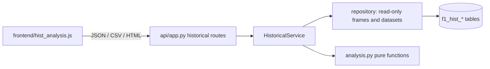

# Design Document

## Overview

This design adds seven read-only historical features to F1 SETUP LAB 2.1. All of them read data already stored by the OpenF1 import. The work splits into three layers:

1. **Pure analysis module** (`integrations/historical/analysis.py`): functions on pandas frames and plain lists, with no database, no network and no FastAPI. Compass conversion, mini-sectors, tyre degradation, season comparison, CSV writing and HTML report building live here, so they can be property-tested directly.
2. **Service and routes**: thin methods on `HistoricalService` that load stored frames, call the pure functions, and return JSON. New routes are added to `api/app.py` beside the existing historical routes.
3. **Frontend**: one new file `frontend/hist_analysis.js` (standings, season comparison, mini-sectors, tyres, export buttons, wind, headshot and colour helpers). `app.js` gets only the router and tab entries.

No new table and no migration is needed (see "Decisions", D1).

## Findings that shape the design

| Finding (verified in code and fixtures) | Consequence |
|---|---|
| OpenF1 `drivers` fixtures contain `headshot_url` and `team_colour`; `driver_list()` in `openf1_normalizer.py` keeps only code, number, name, team | Import must keep two more keys. Existing stored sessions lack them. |
| The driver list is stored in `f1_hist_session.manifest_json`, not in a table | No schema change. No Migration_10. |
| `normalize_weather` already produces `wind_direction_deg` and `rainfall_flag`; they are not in `WEATHER_COLUMNS` and are stored as extra columns | Wind direction needs only a test proving it round-trips, then a frontend change. |
| Championship rows are `{driver, points_start, points_current, position_start, position_current}` and `{team, ...}`; the driver row has no team | The standings screen joins driver rows to the manifest driver list for team, colour and headshot. |
| Laps carry `stint`, `compound`, `tyre_life`, `is_valid`, `is_deleted`, `pits`, `lap_time_s`, `lap_number`, `driver` | Tyre degradation needs no new data. |
| Telemetry frames carry `lap_number`, `distance_m`, `session_time_s`; `distance_m` is an estimate (speed integrated within each lap) | Mini-sectors must say distance is estimated, and must check monotonic distance and time. |
| The existing `compare` route works inside one session and returns 409-style `ValueError` messages (mapped to 422 by the handler) | New routes follow the same error mapping, except where the requirements set 404 or 409. |

## Decisions

**D1. No migration.** Drivers live in the manifest JSON. Requirement 3.1 allowed a Migration_10 only if a column was needed. None is needed, so Requirement 8.3 does not apply and no backup step runs.

**D2. Old sessions get no colours or headshots until re-imported.** The import (`force=true`) refreshes the manifest. The frontend treats missing values as null and falls back to the palette. A backfill from the network is not built: it would add a write path to existing rows for little value.

**D3. Reject, don't repair, bad external values.** `team_colour` must match `^[0-9A-Fa-f]{6}$` and is stored upper-cased. `headshot_url` must be `https`, at most 500 characters, with a host. Anything else is stored as null. The fixtures use two hosts (`media.formula1.com`, `www.formula1.com`), so the frontend does not pin a host list. It loads only the stored URL, with `referrerpolicy="no-referrer"`.

**D4. Analysis is pure.** `analysis.py` imports only `numpy`, `pandas`, `csv`, `io`, `html`, `math`, `statistics`. It does not import the service, the repository, `adapters`, `services` or `game_udp`. A test enforces this (Requirement 8.5).

**D5. Standings come from stored datasets only.** The Standings view calls `datasets/drivers_championship` and `datasets/teams_championship`. A new aggregate route is not needed. The export route builds the standings table from the same stored rows.

**D6. Compass uses 45-degree sectors, wrapping at 360.** `compass(deg)` = `("N","NE","E","SE","S","SW","W","NW")[int(((deg % 360) + 22.5) // 45) % 8]`. This gives 337.5 → N, 22.4 → N, 22.5 → NE, 360 → N, and 359.99 → N.

**D7. Mini-sector method.** For the chosen lap, sort telemetry by `distance_m`. Build `count + 1` boundaries `d_k = d_min + k * (d_max - d_min) / count`. Interpolate `session_time_s` at each boundary with `numpy.interp`. Slice time is the difference of consecutive interpolated times. The sum equals `t(d_max) - t(d_min)`, which is the telemetry lap time. With a reference, the two laps are compared on **normalised distance** (fraction of each lap's own range), because `distance_m` is an estimate that differs per lap. The response states this.

**D8. Degradation method.** Per driver and stint, keep laps where `is_valid` is true, `is_deleted` is false, `pits` is false, the lap is not the first lap of the stint after a pit (out-lap, marked by `tyre_life` being the stint minimum when the lap follows a pit), and the lap is not inside a safety-car or VSC window from `race_control`. Fit `lap_time_s = a + b * tyre_life` by least squares (`numpy.polyfit`, degree 1). `b` is the slope, R² is `1 - SS_res / SS_tot` (null when `SS_tot` is 0). Fewer than 5 usable laps gives null slope with the stated reason. The response always carries the fuel caveat.

**D9. Season comparison cells.** Metrics map to sources:

| Metric | Source | Null reason when missing |
|---|---|---|
| `best_lap` | min `lap_time_s` over valid, non-deleted, non-pit laps | "no valid laps" / "driver not in session" |
| `median_lap` | median of the same laps | same |
| `finish_position` | `session_result` dataset | "session_result not stored" |
| `grid_position` | `starting_grid` dataset | "starting_grid not stored" |
| `points` | `drivers_championship` `points_current - points_start` | "drivers_championship not stored" |

A driver is matched by `code`. The response returns `driver_numbers` per session so the caller can see when a code maps to different numbers.

**D10. CSV safety.** `csv_text(header, rows)` uses `csv.writer` with `lineterminator="\r\n"`. Before writing, every string cell starting with `=`, `+`, `-` or `@` gets a leading `'`. Numeric cells are written unchanged, so negative numbers are not altered (they are `float`, not `str`). Null is an empty cell.

**D11. Report is one escaped HTML string.** `report_html(...)` builds it with `html.escape` on every stored value. It contains a small inline `<style>` and no `<script>`, no `<link>`, no `` to other hosts. Headshots are not embedded in the report.

## Architecture



The write guard on the historical engine stays installed. The new routes only read.

## Backend changes

### Import: keep colour and headshot (Requirement 3)

`openf1_normalizer.driver_list` adds two keys per driver:

```python
{"code": ..., "number": ..., "name": ..., "team": ...,
 "team_colour": clean_colour(r.get("team_colour")),
 "headshot_url": clean_url(r.get("headshot_url"))}
```

`clean_colour` and `clean_url` live in `analysis.py`-independent helper code in the normalizer. Both return `None` for invalid input. `drivers_preview` uses `driver_list`, so the preview carries the keys too. The drivers response of a stored session reads `manifest["drivers"]`, so it gains the keys automatically, with `None` for sessions imported before this change (the service fills missing keys with `None` so the response shape is the same for old and new sessions).

### New and changed routes

| Route | Purpose | Errors |
|---|---|---|
| `POST /api/historical/compare-sessions` | Season comparison (Req 4) | 404 unknown session id, 422 bad field |
| `GET /api/historical/sessions/{id}/mini-sectors` | Mini-sectors (Req 5) | 404 session, 422 bad driver or `count`, 409 unusable telemetry |
| `GET /api/historical/sessions/{id}/tyre-degradation` | Tyre degradation (Req 6) | 404 session; 200 with empty list when no stints |
| `GET /api/historical/sessions/{id}/export.csv?table=` | CSV (Req 7) | 404 session, 422 unknown table |
| `GET /api/historical/sessions/{id}/report.html` | Report (Req 7) | 404 session |
| `GET /api/historical/sessions/{id}/drivers` | gains `team_colour`, `headshot_url` | unchanged |

Status mapping needs care. The app maps `ValueError` to 422 today. Mini-sector failures need 409 and unknown session ids in `compare-sessions` need 404. The service raises `app_errors.NotFound` for missing sessions (already mapped to 404) and `app_errors.Conflict` for unusable telemetry (already mapped to 409). It raises `ValueError` only for bad input. No new exception handler is needed.

Request model for season comparison (in `integrations/historical/schemas.py`, class names unique across both schema modules):

```python
class SeasonCompareRequest(BaseModel):
    sessions: list[str] = Field(min_length=2, max_length=24)
    drivers: list[str] = Field(min_length=1, max_length=6)
    metric: Literal["best_lap", "median_lap", "finish_position", "grid_position", "points"]
```

Response:

```json
{"metric": "best_lap", "unit": "seconds",
 "sessions": [{"session_id": "...", "label": "2024 Monza Qualifying", "year": 2024, "session_type": "Q", "date": "..."}],
 "series": [{"driver": "VER", "cells": [{"session_id": "...", "value": 80.5, "driver_number": "1", "reason": null}]}]}
```

`sessions` is ordered by `session_date` ascending (ties by `session_id`). Every driver has one cell per session.

Mini-sector response:

```json
{"driver": "VER", "lap": 12, "lap_source": "fastest|requested", "count": 25,
 "distance_note": "distance is an estimate (speed integrated within each lap); laps are compared on normalised distance",
 "lap_time_s": 80.1, "sum_slices_s": 80.1,
 "slices": [{"index": 0, "start_frac": 0.0, "end_frac": 0.04, "time_s": 3.2, "ref_time_s": 3.25, "delta_s": -0.05, "cum_delta_s": -0.05}]}
```

`ref_*` and `delta_s` keys are present only when a reference is given.

Tyre degradation response:

```json
{"stints": [{"driver": "VER", "stint": 1, "compound": "SOFT", "tyre_age_first": 1, "tyre_age_last": 18,
             "laps_used": 15, "laps_excluded": {"pit": 2, "invalid": 1, "safety_car": 0},
             "slope_s_per_lap": 0.062, "r_squared": 0.71, "reason": null}],
 "by_compound": [{"compound": "SOFT", "median_slope_s_per_lap": 0.058, "stints": 4}],
 "caveat": "Fuel burn is not corrected; a negative slope can be caused by falling fuel load.",
 "coverage_note": null}
```

### CSV tables

| `table` | Source | Columns |
|---|---|---|
| `laps` | `HistoricalService.laps` | same keys as the laps route |
| `results` | `datasets/session_result` | its stored keys |
| `standings` | both championship datasets | `kind` (driver/team), `position`, `name`, `team`, `points_start`, `points_current` |
| `weather` | `weather` route | its keys |
| `tyre_degradation` | tyre-degradation `stints` | its keys flattened |
| `mini_sectors` | mini-sectors `slices` | its keys; query params as for the route |

Each table is built from the same service method as the JSON route, so values match (Requirement 7.3).

### Report sections

Summary (event, session, date, source OpenF1), results, standings (or "unavailable"), tyre degradation (with caveat), weather summary (min, max, mean per channel, wind direction as compass), and the historical notice. Missing section: heading plus the text "unavailable: <reason>".

## Frontend changes

### Navigation and router

Seven entries in three groups. The Historical F1 group becomes: Historical F1 (`#/hist`), Imported sessions (`#/sessions`), Standings (`#/standings`), Season comparison (`#/season`). With the four from the other groups that is eight, which contradicts Requirement 1.1 ("exactly seven"). **Requirement 1.1 is wrong as written and needs one fix:** Setup Engineering has 3, Live Simulator has 1, Historical F1 has 2 now; adding Standings and Season comparison gives 3 + 1 + 4 = **8** entries. The requirements file will be corrected to eight.

New session tabs are added to `HIST_TABS`: `['minisectors', 'Mini-sectors']` and `['tyres', 'Tyres']`. Export buttons sit in the session header.

### Files and helpers (`hist_analysis.js`)

| Export | Role |
|---|---|
| `compass(deg)` | Same logic as D6. Property-tested with the Python version through a shared table of cases. |
| `teamColour(driverOrTeam, meta)` | Returns `#RRGGBB` or the palette colour. |
| `distinguish(seriesList)` | Assigns dash patterns when two series share a colour. |
| `avatar(driver)` | Returns an `` (32 px, `referrerpolicy="no-referrer"`, `onerror` swap) or a coloured circle with the code. |
| `viewStandings()`, `viewSeason()`, `miniSectorsTab()`, `tyresTab()`, `exportButtons()` | Views. |

`app.js` already uses `esc`, `api`, `view`, `Charts`; the new file uses them without redeclaring. Script order: `charts.js, inspector.js, hist_race.js, hist_picker.js, setup_lab.js, hist_analysis.js, app.js`. The Playwright and static tests must be updated for the new order.

### Behaviour details

- **Standings:** `#/standings` shows a session picker (stored race and sprint sessions), then two tables. Points gained is `points_current - points_start`. Team for a driver row comes from the manifest drivers. Statuses other than `ok` or zero rows show the coverage note.
- **Wind:** the weather tab adds a "Wind direction" chart and a table column with degrees and compass point. Null samples are dropped from the line and listed as "no data". If every sample is null, one note replaces the chart.
- **Colours:** hist views read colours from the drivers response. Two drivers with the same colour get `stroke-dasharray` `0` and `6 3`. Meaning is never colour-only: legends and tables carry the driver code.
- **Season comparison:** the session list comes from `GET /api/historical/sessions`. A point is drawn only when `value` is not null. Reasons appear in a list under the chart.
- **Notices:** all new views show the historical notice and never the synthetic or simulator notice, using the existing `showNotice('historical')` call.

## Error handling

| Case | Result |
|---|---|
| Unknown session id on any new route | 404 `id not found: <id>` (existing `NotFound` class) |
| `count` outside 10 to 50, unknown metric, unknown `table`, bad list lengths | 422 with the field name |
| Mini-sector telemetry missing or non-monotonic over more than 10 percent of samples | 409 naming the channel (`distance_m` or `session_time_s`) |
| Tyre data missing | 200, `stints: []`, `coverage_note` set |
| Championship dataset empty or beta endpoint failed | Standings view shows the coverage note and status |
| Headshot fails to load | Coded circle fallback |
| Unexpected exception | Existing catch-all 500 with the fixed body |

## Correctness properties

Each property is tested with Hypothesis (at least 100 examples unless noted) in files named `tests/test_prop_phase1_*.py`.

1. **Compass sector.** For any float `d`, `compass(d)` equals the sector of `d mod 360`; `compass(d) == compass(d + 360)`; boundary values 22.5 and 337.5 map as in D6. *(Req 2.5)*
2. **Colour and URL cleaning.** For any string, `clean_colour` returns either a six-hex-digit upper-case string or `None`; `clean_url` returns either an `https` URL of at most 500 characters or `None`; neither raises. *(Req 3.3)*
3. **Mini-sector sum.** For any strictly increasing distance and time arrays (at least 20 samples) and any `count` in 10..50, the slice times sum to the lap time within 1e-9, every slice time is non-negative, and the number of slices equals `count`. *(Req 5.2, 5.6)*
4. **Mini-sector reference antisymmetry.** Swapping driver and reference negates every `delta_s` and `cum_delta_s`. *(Req 5.3)*
5. **Mini-sector rejection.** If distance or time is not increasing over more than 10 percent of samples, the function raises `Conflict` and returns no values. *(Req 5.4)*
6. **Degradation recovery.** For generated stints with `lap_time = a + b * age` plus bounded noise of at most 0.02 s and at least 5 laps, the fitted slope is within `0.05` of `b` (exact when noise is zero); with fewer than 5 usable laps the slope and R² are `None` with the stated reason. *(Req 6.2, 6.3)*
7. **Degradation exclusions.** Laps flagged invalid, deleted, pit or inside a safety-car window never contribute: adding such laps with extreme times does not change the slope. *(Req 6.2)*
8. **Season comparison shape.** For any stored sessions and drivers, the response has exactly one cell per driver per session in date order, and a cell has either a value or a reason, never both and never neither. *(Req 4.2, 4.3)*
9. **CSV safety and round trip.** For any rows of strings, numbers and nulls, parsing the output with `csv.reader` returns the same cells, except that strings starting with `=`, `+`, `-` or `@` come back prefixed with `'`; numbers are unchanged. *(Req 7.2)*
10. **Export equals JSON.** For each of the six tables, the CSV cells equal the JSON route values for the same session (null as empty). *(Req 7.3)*
11. **Report escaping.** For any stored string values containing `<`, `>`, `&` and quotes, the report never contains them unescaped, and the document contains no `<script`. *(Req 7.5)*
12. **Read-only.** After calling every new route in a random order with random valid parameters, a snapshot of all tables is byte-identical to the one before. *(Req 4.7, 5.8, 6.9, 7.8, 8.1)*
13. **Route stability.** The regenerated route manifest differs from the committed one only by added routes and the two driver keys. *(Req 8.2)*
14. **Import keeps colour and headshot.** For the driver rows of each OpenF1 fixture, `driver_list` returns the cleaned `team_colour` and `headshot_url`; invalid values become `None`. *(Req 3.1, 3.2)*

## Testing strategy

- **Unit tests** (`tests/test_phase1_*.py`): fixture-based checks of each route against the five OpenF1 fixtures, including the empty-data cases (no stints, no championship) and the status codes in the error table. A test confirms `wind_direction_deg` survives import and read (it is stored as an extra column, not a declared one).
- **Static tests**: `analysis.py` imports only the allowed modules; no new route reads or writes a non-historical table; `index.html` lists eight entries in three groups; script order is as specified.
- **Frontend tests (Playwright, same gate as the existing UI tests)**: standings with data, with a failed dataset, and for a qualifying session; wind chart with data, partial nulls and all nulls; headshot load failure; two drivers with one colour; season comparison with a null cell; mini-sector and tyre tabs render with fixture data; export buttons download a file.
- **Updates to existing tests (Requirement 8.6)**: `test_frontend_setup_lab.py` (allowed router heads, tab keys, script order, forbidden-word scan limited to "synthetic" and "wind direction" removed), `test_backend_restoration.py` (route list), the route manifest and its stability test (regenerate with `scripts/gen_historical_manifest.py`).

## Verification limits

The live OpenF1 tests, real headshot loading from formula1.com hosts and `scripts/check-release.sh` cannot run here. Tests use recorded fixtures only.

## Risks

- **`distance_m` is an estimate.** Mini-sector boundaries are only as good as that integration. The response says so, and the 5.6 sum check uses time, which is measured.
- **Safety-car detection depends on race control text.** If a session has no race control rows, no laps are excluded for that reason and the response says so.
- **Old sessions show no colours or headshots** until re-imported (D2).
- **Beta championship endpoints** can be empty for any session; the UI shows the coverage note instead of failing.
