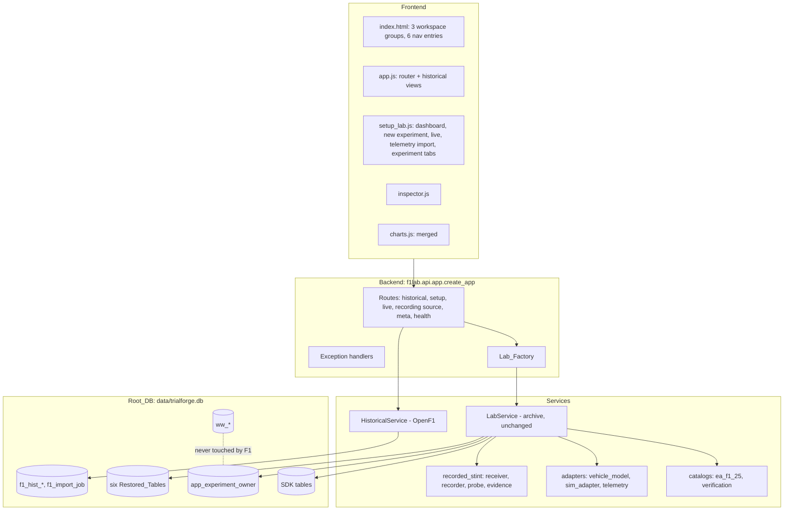

> **Note (removed feature).** The recorded-stint feature described in this document was removed from F1 SETUP LAB (migration 10; see the note in `requirements.md`). Parts of this document that describe it no longer apply.

# Design Document

## Overview

This feature restores the setup engineering system and the recorded-stint feature to F1 SETUP LAB and ships it as version 2.1.0. The app keeps its OpenF1 historical features and gains two more workspaces. Most of the work is restoring files from the Release_Archive, and the design effort goes into the places where the archive cannot be dropped in unchanged:

- `api/app.py`, `__init__.py`, `charts.js`, `app.js`, `index.html`, `conftest.py`, `pyproject.toml` and `db/models/f1.py` exist in both the current tree and the archive, and the two versions have diverged. They are merged by hand.
- The Backend gets an injectable Lab_Factory, a generic 500 handler and a merged `/api/meta` and `/api/health`. The archive has none of these.
- Migration 9 recreates six tables. It needs a pre-migration backup, which the migration runner does not provide today.
- Data separation (Requirement 6) is enforced by a table allow-list guard, not only by convention.
- The start script and the release check currently assert that F1 SETUP LAB does not use the SDK. That reverses.

### Sources and how they were verified

The archive `~/Downloads/skeleton-kiro-main (1).zip` was unzipped to `/tmp/rel/` and compared with the workspace and with git commit `dfa519e` ("Snapshot before removing the simulator, EA F1 recording source and FastF1"). Every restored file I compared (adapters, catalogs, services, `api/schemas.py`, all of `recorded_stint/`, `inspector.js`, the three scripts, the test modules) is byte-identical between the archive and `dfa519e`. Either source is therefore valid. The restoration manifest (see Testing Strategy) is computed from the archive, and `dfa519e` is a cross-check.

### Discrepancies between the requirements and the sources

These need a decision or an explicit deviation. Each is reflected in the design below.

| # | Requirement | Finding | Design response |
|---|---|---|---|
| D1 | Glossary: models are `F1Recording`, `F1Packet`, `F1StintEvidence`, `F1StintTelemetry`, `F1ProbeReport`, `F1SetupMappingConfirmation` | The archive classes are `Recording`, `Packet`, `StintEvidence`, `StintTelemetrySample`, `ProbeReport`, `SetupMappingConfirmation`. The restored code (`evidence.py`, `recorder.py`, `verification.py`) imports these names. | Keep the archive class names, since renaming would break byte-identical restored modules. The glossary should be corrected. |
| D2 | 4.6: `NOTICES` string-equal to the archive | The archive `NOTICES["historical"]` says "retrieved via the FastF1 library". The current `HISTORICAL_NOTICE` says OpenF1. `tests/test_notices.py` line 28 asserts the word "FastF1". | `NOTICES["synthetic"]` and `NOTICES["recorded_stint"]` are string-equal to the archive. `NOTICES["historical"]` keeps the current OpenF1 text. `test_notices.py` is rewritten for this. `__init__.py` is merged, not copied. |
| D3 | 4.5: `api/schemas.py` defines "every current historical schema class" | The historical request classes live in `integrations/historical/schemas.py`, and there is no `api/schemas.py` now. The archive file has 11 classes and no historical ones. | `api/schemas.py` is copied unchanged. Historical schemas stay where they are. 4.5 is satisfied by the union of the two modules with no duplicate class name. |
| D4 | 5.2: Lab_Factory | The archive `create_app(db_path, frontend_dir, fastf1_client_factory, openf1_client_factory)` always builds `LabService(db_path)`. Archive tests reach it through `client.app.state.lab`. | New parameter `lab_factory`. `app.state.lab` stays for the restored tests. |
| D5 | 5.3, 5.4 | `services/lab.py` defines its own `NotFound` and `Conflict`. `f1lab/errors.py` defines different classes with the same names. `lab.py` must stay byte-identical, so it cannot import the shared ones. | Register handlers for both class pairs. The shared 404 handler already formats `not found: <arg>`. |
| D6 | 5.10: HTTP 500, "no partial Lab_Service state change" | The archive has no catch-all handler. The Backend cannot make arbitrary Lab_Service code atomic. | Add a catch-all handler that returns a fixed-shape 500 without a traceback. State atomicity is whatever `LabService` already guarantees. The Backend only promises that the handler itself writes nothing. |
| D7 | 5.5, 5.6 | The archive `/api/meta` (experiment factors, recording source variants, modes, notices) and the current `/api/meta` (`notice`, `provider`, `first_year`) have different shapes. The restored frontend code reads the archive keys. The archive health returns `recovered`, the current one `data` and `interrupted_imports`. | Merged responses. Archive keys are kept as they are. New key `modules` lists both modules. Current keys are kept. |
| D8 | 1.9, 1.10 | `start-f1.sh` never queries `/api/health` today. `check-release.sh` queries it with a 900 s startup timeout and compares the SDK version only for WATTWISE. | Add a 30 s health check after the process starts to `run_app` for SDK apps. The release smoke test relies on it. |
| D9 | 9.7: reproduce the pandas 3.0 failure | A full run in this workspace gave 88 passed, 5 skipped, 0 failed (Python 3.12, pandas 2.3.3, `.venv`). The audit's 1 failure does not reproduce. | The baseline is recorded in the test report. Reproducing it needs pandas 3.x. Task: run the suite in a venv with `pandas>=3` and record the result either way. |
| D10 | 9.3: skipped tests | 5 tests are currently skipped (opt-in network and browser tests). 9.3 only forbids skips caused by a missing FastF1. | The 5 opt-in skips stay. They are listed in the report. |
| D11 | 4.8 | Restoring `api/app.py` with archive imports would load `recorded_stint`, adapters and `lab` whenever the app module is imported. 4.8 only constrains `f1lab.integrations.historical`. | `integrations/historical/__init__.py` imports nothing from the setup packages. The new `app.py` imports the lab modules, which is allowed. |
| D12 | Existing tests that contradict the feature | `tests/test_app_scoping.py` says F1 keeps no experiments. `tests/test_start_scripts.py:54` asserts `sdk:     not used by F1 SETUP LAB`. `check-release.sh` lines 218 to 237 assert F1 does not use the SDK. `db` tests that assert version 8 as latest. | These are updated as part of the work. Req 3.11 names only one of them. |
| D13 | Stale tree | `f1-setup-lab/build/lib/` holds a pre-removal copy of the app. | It is not a source and is not touched. |
| D14 | Hypothesis | The property tests need Hypothesis, which is not installed in `.venv`. | Add `hypothesis>=6` to the test extras of the root package and `f1-setup-lab`. |

The route count also differs from the text. The archive has 53 routes, of which 33 are restored (`/api/experiments*` 21, `/api/live/*` 4, `/api/<verification>/*` 3, `/api/telemetry/preview`, `/api/demo/{name}.csv`, plus the telemetry and series routes). The requirement says "about 35", which is consistent. The current app has 21 `/api/historical/*` routes (including the OpenF1 cache and datasets routes, which the archive lacks) and `/api/frontend-build`.

## Architecture



Dependency rule: `integrations/historical` must not import `lab`, `recorded_stint`, `adapters` or `catalogs`. The reverse direction is also absent. The only place the two sides meet is `api/app.py`.

### Restore plan by area

| Area | Action |
|---|---|
| `adapters/` (3 files + `__init__`), `catalogs/` (2 + `__init__`), `services/` (`lab`, `narrative`, `report_html`, `__init__`), `integrations/recorded_stint/` (11 files), `api/schemas.py`, `frontend/inspector.js`, three scripts | Copy from the archive. Byte-identical. |
| `f1lab/__init__.py` | Merge (see D2). Version `2.1.0`. Keep `notice_for`. Keep the current `HISTORICAL_NOTICE` text. |
| `api/app.py` | Merge by hand (see Components). |
| `db/models/f1.py` | Append the six archive classes and the imports `LargeBinary` and `UniqueConstraint`. Nothing else in the file changes. |
| `db/migrations/versions.py` | Append migration 9, update two docstrings. |
| `frontend/` | New `setup_lab.js`. Merge `charts.js`. Edit `index.html`, `app.js`, `style.css`. |
| `pyproject.toml` | Edit. |
| `tests/` | Restore 11 modules plus `stint_packets.py`. Merge `conftest.py`. Add new tests. |
| `scripts/*.sh`, `scripts/lib/common.sh` | Edit. |
| READMEs | Edit. |

## Components and Interfaces

### 1. Database models (`db/models/f1.py`)

Append the archive classes with these table names: `<recording table>`, `<packet table>`, `f1_stint_evidence`, `f1_stint_telemetry`, `f1_probe_report`, `f1_setup_mapping_confirmation`. The only constraint beyond primary keys is `uq_f1_setup_mapping_confirmation_factor_variant` (unique on `factor`, `game_variant`), and `<packet table>.recording_id` is a foreign key with `ON DELETE CASCADE`. The archive `f1.py` itself is not copied: it predates `HistDataset` and still defaults the provider to `fastf1`.

Req 2.6: a duplicate table name already raises `InvalidRequestError` from SQLAlchemy at class creation, naming the table. No custom code is needed. A test confirms the message contains the table name.

### 2. Migration 9 (`db/migrations/versions.py`)

```python
def _m009_f1_setup_restored(conn):
    create_tables(conn, "app_experiment_owner", "<recording table>", "<packet table>", "f1_stint_evidence",
                  "f1_stint_telemetry", "f1_probe_report", "f1_setup_mapping_confirmation")
```

`create_tables` uses `Table.create(checkfirst=True)`, which is CREATE TABLE IF NOT EXISTS semantics, and it creates the table's indexes with it. Order is parents first (`<recording table>` before `<packet table>`). Migration 4 stays a no-op, because versions of existing databases must keep their meaning. Its docstring gains the sentence that migration 9 recreates the tables migration 8 removed. Migration 8's docstring gains "one-time cleanup".

The runner already wraps each migration and its `app_schema_version` row in one `BEGIN IMMEDIATE` transaction, so a failing statement rolls back everything and leaves version 8 (Req 3.9). The `MigrationError` message names the migration but not the failing statement. The design adds the statement: `create_tables` is wrapped so the exception names the table being created.

**Fresh databases** go through 4 (no-op), 8 (drop if exists, no-op) and 9 (create), so they end with the same schema as upgraded ones.

### 3. Pre-migration backup (`db/backup.py`, hook in `db/migrations/runner.py`)

Req 3.7 and 3.8 need a backup that completes before the first statement of migration 9 and that aborts cleanly on failure. SQLite here runs in WAL mode (`db/engine.py`), so copying only the main file can miss committed pages that still sit in the `-wal` file, and a checkpoint would modify the file that must stay byte-identical on abort. The design therefore uses the SQLite online backup API on a read-only connection.

```python
# db/backup.py
class BackupError(RuntimeError): ...
def backup_database(db_file: Path, now: datetime | None = None) -> Path:
    """Write data/backups/<YYYYmmddTHHMMSSZ>/trialforge.before-migration-9.db and return its path.
    Raises BackupError (before touching db_file) if the copy cannot be written or its size differs from the source."""
```

Steps: open the source with `file:...?mode=ro`, run `Connection.backup()` into a temp file in the target directory, compare `st_size` of the copy with `page_count * page_size` of the source and with `st_size` of the source file when no WAL content is pending, then rename the temp file to its final name. The directory name follows the existing convention in `data/backups/` (`20261121T135410Z`).

The runner gets one optional argument: `migrate(engine, target=None, migrations=None, before_apply=None)`. `before_apply(migration)` runs before the transaction of each pending migration. `db.migrate.main` and `create_app` pass `db.backup.backup_hook`, which backs up only when all of these hold: the migration is version 9, the database is a file, the file exists and is non-empty, and `app_schema_version` already shows a version below 9. Fresh databases are not backed up. A `BackupError` is converted to `MigrationError` and propagates before any statement runs. `db.migrate.main` catches it, prints the error naming the backup failure, and returns exit code 1. `create_app` lets it raise, so the app does not start on an un-backed-up upgrade.

Both entry points call the same hook, so starting the app directly (without `start-f1.sh`) still gets a backup.

### 4. `f1lab/__init__.py`

Version `2.1.0`. Docstring rewritten for three workspaces (no FastF1 text). Constants: `SYNTHETIC_NOTICE` and `SIM_RECORDED_NOTICE` byte-identical to the archive, `HISTORICAL_NOTICE` as it is now, `NOTICES = {"synthetic", "recorded_stint", "historical"}`, `notice_for` unchanged.

### 5. Backend (`f1lab/api/app.py`)

```python
def create_app(db_path=None, frontend_dir=None, openf1_client_factory=None, lab_factory=None) -> FastAPI:
    engine = create_db_engine(resolve_db_url(db_path)); migrate(engine, before_apply=backup_hook)
    lab = (lab_factory or (lambda: LabService(db_path)))()
```

- `lab_factory` is a zero-argument callable returning an object with the `LabService` interface. When supplied, `LabService(db_path)` is never constructed, so the default database is not read or written by the lab. The historical service still uses `db_path` (tests that pass a stub lab also pass `db_path`). `app.state.lab`, `app.state.historical`, `app.state.engine` are all set.
- The `fastf1_client_factory` parameter is dropped. No restored test passes it after the FastF1 tests are excluded.
- The lifespan runs `hist.recover()` and `lab.startup()`, and on shutdown `hist.shutdown()` and `lab.shutdown()`.
- Routes: the 33 restored routes are copied from the archive with the same paths, methods and status codes. The archive's 18 FastF1-era `/api/historical/*` routes are not copied. The 21 current historical routes stay as they are. One archive route, `/api/historical/*` aside, needs care: `Provider` and `HistoricalImportRequest` are not used by restored routes.
- The `lab` variable is the closure each restored route uses. Routes must not call `LabService` directly.

**Exception handlers** (first match wins, specific before general):

| Exception | Status | Body |
|---|---|---|
| `RequestValidationError`, pydantic `ValidationError` | 422 | `{"detail": [{"field", "message"}, ...]}`, one entry per invalid field (existing handlers) |
| SDK `ValidationError`, `DesignError` | 422 | as archive |
| `f1lab.errors.NotFound`, `services.lab.NotFound` | 404 | `not found: <message>` |
| `f1lab.errors.Conflict`, `services.lab.Conflict`, SDK `OptimizationError`, `ExecutionError`, `InvalidTransitionError` | 409 | message |
| `TrialforgeError` | 400 | as archive |
| `OpenF1Error` | 502 | existing |
| `ValueError` | 422 | existing |
| any other `Exception` | 500 | `{"detail": [{"field": "server", "message": "internal error"}]}`, error logged server-side with the traceback |

A `/api/demo/{name}.csv` with an unknown name returns 404 `demo not found: <name>` (the archive already does this through `HTTPException`; the design keeps it and adds a test).

Known limit: Starlette's catch-all handler runs in `ServerErrorMiddleware`, which re-raises after sending the response. Tests of the 500 path must construct `TestClient(app, raise_server_exceptions=False)`.

**`/api/health`** returns the existing fields (`status`, `app`, `version`, `data`, `interrupted_imports`) plus `trialforge` (`trialforge.__version__`), `trialforge_path` (directory of the loaded package) and `recovered`. `data` stays `"openf1"` for the historical part. No existing key changes name or type.

**`/api/meta`** returns the union: the archive keys (`notice`, `notices`, `modes`, `recording source`, `version`, `trialforge_version`, `factors`, `default_factors`, `methods`, `optimisers`, `telemetry_columns`) plus the current keys (`provider`, `first_year`) plus `modules: [{"id": "historical", "label": "Historical F1"}, {"id": "setup", "label": "Setup Engineering"}]`. `notice` keeps its archive meaning (the synthetic notice). The historical frontend views read `notices.historical` instead of `notice`; see Frontend.

### 6. Data separation guard (`db/guard.py`)

Requirement 6.8 asks for rejection of writes to non-permitted tables. Conventions alone cannot give that, so the design adds a small guard.

```python
PERMITTED = {
  "historical": {"f1_hist_session", "f1_hist_frame", "f1_hist_dataset", "f1_hist_lap", "f1_hist_weather",
                 "f1_hist_telemetry", "f1_hist_position", "f1_import_job"},
  "setup": SDK_EXPERIMENT_TABLES | {"measurements", ... , "app_experiment_owner", six Restored_Tables},
}
class TableNotPermitted(Exception): ...
def install_guard(engine, domain: Literal["historical", "setup"]) -> None: ...
```

`install_guard` attaches a `before_cursor_execute` listener. It extracts the target table of `INSERT [OR x] INTO`, `UPDATE`, `DELETE FROM` and `REPLACE INTO` statements with one anchored regular expression, and raises `TableNotPermitted("table 'x' is not permitted for <domain> writes")` if the name is outside the set. Reads are not restricted by the guard (the read side of 6.2 is covered by a test that records table names). The historical service engine gets the `historical` guard. The lab's repository engine gets the `setup` guard.

Risk: the SDK's `SQLiteExperimentRepository` may write to tables not in `SDK_EXPERIMENT_TABLES` or through its own connection. Task 1 of implementation lists the SDK's tables from its source and confirms the engine it uses. If the SDK bypasses the SQLAlchemy engine, the guard covers only app-owned writes and the property tests check the rest by table snapshots. `db.migrate` runs on an unguarded engine, because migrations legitimately touch all tables.

### 7. Frontend

`index.html` has six links in three groups. Group headings are real elements, and each link sits under exactly one:

| Group | Entries |
|---|---|
| Setup Engineering | Dashboard (`#/dashboard`), New experiment (`#/new`), Telemetry import (`#/telemetry`) |
| Recorded Stint | Recorded stint (`#/live`) |
| Historical F1 | Historical F1 (`#/hist`), Imported sessions (`#/sessions`) |

Script order: `charts.js`, `inspector.js`, `hist_race.js`, `hist_picker.js`, `setup_lab.js`, `app.js`. Classic scripts share one global scope, so two `const`/`function` declarations of the same name in different files are a SyntaxError. The split rules:

- `app.js` keeps what it has now: `esc`, `fmt`, `$`, `view`, `META`, `ApiError`, `api`, `toast`, `errorsBox`, `setNav`, `setLed`, `downsample`, the router, and all historical views. These helpers are the shared ones.
- `setup_lab.js` is cut from archive `app.js` lines 22 to 575 (`poll`, `statusChip`, `progress`, `label`, `LIVE`, `isLive`, `SECOND`, `cap`, `flabel`, `setBanner`, `unit`, `isActive`, `TABS`, all `view*` functions up to `viewReport`, the telemetry import helpers, `WHEELS`, chart helpers). It must not redeclare `esc`, `fmt`, `$`, `view`, `META`, `ApiError`, `api`, `toast`, `errorsBox`, `setNav`, `setLed` or `downsample`. These are removed from the cut, since `app.js` defines them.
- The archive's historical block (lines 576 to the end: `histChipFor`, `histCoverage`, `brakeOf`, `viewHist`, `viewHistSession`, `histTraceCharts`) is not used. It is FastF1-based and the current files replace it.
- Route table: `route()` in `app.js` dispatches `dashboard`, `new`, `live`, `telemetry` and experiment ids to functions defined in `setup_lab.js`, and `hist` and `sessions` to the historical views. The empty hash redirects to `#/dashboard`. The archive landing page is `#/`; the new landing choice (dashboard) is an assumption and can be changed to `#/hist` in one line.
- Banner: `setBanner(mode)` from `setup_lab.js` writes `META.notices[mode]`. Historical views write `META.notices.historical`. The synthetic notice is visible in the banner whenever a Simulator view is open, and the recorded-mode notices on the Live view. Both are in the fixed header, so they are in the viewport without scrolling.
- Errors: the existing `api()` wrapper throws `ApiError`. Every view's catch block calls `errorsBox`, which renders the message in the current view while previously rendered data stays in the DOM, because views render into a nested container and replace only that container. A fetch failure with no JSON body produces `request failed` (Req 7.12).
- No view shows wind direction. The archive and current charts do not plot it, and a static test scans for `wind_direction` in the frontend.
- `charts.js` is the union. The current file exports `lines, sectors, trackMap, esc, f`. The archive exports `scatter, bars, lines, sectors, trackMap, esc, f`. The merged file keeps the current implementations of the shared names and adds `scatter` and `bars` from the archive. Where `lines` or `sectors` differ between the two files, the merge task diffs them and keeps the superset of options, so both callers still render. A Playwright check covers one chart of each type.

### 8. Scripts

`scripts/start-f1.sh` calls `run_app ... f1-setup-lab "${1:-start}" yes`. `run_app` already builds the wheel if missing (`ensure_wheel`) and installs it (`install_app`), and `ensure_wheel` already calls `die` (exit 1 with a message) before the backend starts, which satisfies 1.5 and 1.6. The header comment of `start-f1.sh` is corrected.

`run_app` gains a post-start health check (D8). After launching the process it polls `/api/health` for up to `HEALTH_TIMEOUT` (default 30) seconds. It compares `trialforge` with the version of the wheel it installed (`sdk_version`). On mismatch, a missing field, or no response, it prints a message naming the cause, kills the child, and exits 1.

`scripts/check-release.sh`:
- Header comment says both apps use the SDK.
- `health_ok` checks the SDK version for both apps and treats a missing `trialforge` as failure.
- Lines 218 to 237 (the assertion that F1 has no SDK dependency, imports no SDK, and has no `trialforge` in `f1app.__dict__`) are replaced by the same assertions as for WATTWISE: the SDK is imported from site-packages and `f1-setup-lab` accepts the wheel's version. A new assertion fails if `fastf1` is in `f1-setup-lab`'s requirements.
- The F1 test run already comes after the wheel install (line 201 builds it and 204 installs the app), so the SDK wheel is installed before F1 tests run (1.7). The F1 install line changes to install the wheel first and fail with an explicit message if it is missing (1.8).

### 9. `f1-setup-lab/pyproject.toml`

Version `2.1.0`. Description (under 200 characters): "F1 SETUP LAB: Setup Engineering, Recorded Stint and Historical F1 workspaces, built on the TRIALFORGE SDK, with real historical data from OpenF1". One `trialforge-core>=0.2.0,<0.3` dependency (the SDK in this workspace is 0.2.1). `pandas`, `numpy` and `certifi` stay. `hypothesis>=6` is added to `test`. Per-file ignores add `protocols/*.py` and `capture.py` for E702, keeping the E712 ignore for tests.

## Data Models

### Restored tables

| Table | Columns | Keys and constraints |
|---|---|---|
| `<recording table>` | `recording_id` str(60), `started_at` datetime, `host` str(100) null, `port` int null, `source` str(40) default `live`, `note` text null | PK `recording_id` |
| `<packet table>` | `recording_id` str(60), `seq` int, `received_at` float, `data` blob | PK (`recording_id`, `seq`), FK to recording, ON DELETE CASCADE |
| `f1_stint_evidence` | `experiment_id` str(100), `run_id` str(100), `payload_json` text, `recorded_at` datetime | PK (`experiment_id`, `run_id`) |
| `f1_stint_telemetry` | `experiment_id`, `run_id`, `seq` int, `session_time` float null, `sample_json` text | PK (`experiment_id`, `run_id`, `seq`) |
| `f1_probe_report` | `report_id` str(60), `created_at`, `packet_format` int null, `game_variant` str(40) null, `recording_id` str(60) null, `report_json` text | PK `report_id` |
| `f1_setup_mapping_confirmation` | `id` int autoincrement, `factor` str(60), `game_variant` str(40), `<mapping field>` str(60), `verified` bool, `low_value_seen` float null, `high_value_seen` float null, `probe_report_id` str(60) null, `confirmed_by` str(100), `note` text null, `confirmed_at` datetime | PK `id`, unique (`factor`, `game_variant`) |

These come from the archive model file, not from a hand-written DDL. A checked-in golden schema file (`tests/fixtures/restored_schema.json`, produced from the archive's own migration 4 on an empty database) holds the `PRAGMA table_info`, `index_list` and `foreign_key_list` output. A test compares the schema created by migration 9 with it (Req 2.1, 2.4).

### Data domains

| Domain | Tables | Writers |
|---|---|---|
| Historical | `f1_hist_*`, `f1_import_job` | `HistoricalService`, importer |
| Setup | SDK tables, six Restored_Tables, `app_experiment_owner` (`app = 'f1-setup-lab'`) | `LabService`, `evidence.py`, `recorder.py`, `verification.py` |
| WATTWISE | `ww_*`, `app_experiment_owner` (`app = 'wattwise-lab'`) | not touched by F1 |

No route reads from one domain to write into another (Req 6.5).

### Test manifests (new files under `f1-setup-lab/tests/fixtures/`)

- `restoration_manifest.json`: path to sha256 for every restored file (adapters, catalogs, `recorded_stint`, services, `api/schemas.py`, `inspector.js`, three scripts, and the restored tests with the changes listed below). Built from the archive. Used by 4.1 to 4.4, 4.9 and 8.1.
- `historical_routes.json`: for each current `/api/historical/*` route, method, path, request schema, response schema and, for GET routes, the top-level keys and value types for each OpenF1 fixture session. Generated from the current code before any restoration change lands, and committed first. Used by 5.7 and 9.9.
- `restored_schema.json`: see above.

### Restored tests

| Module | Handling |
|---|---|
| `test_api_workflow`, `test_recorded_stint`, `test_live_mode`, `test_probe_and_verification`, `test_protocol_2026`, `test_stint_measurements`, `test_telemetry_inspector`, `test_vehicle_and_telemetry`, `test_csv_timestamps`, `stint_packets` | Copy unchanged. |
| `test_notices` | Rewrite the FastF1 assertion (D2). |
| `test_verification_scripts` | Drop the `smoke_fastf1_import` tests (lines 70 to 86). Keep the rest. |
| `conftest.py` | Merge. Both files define `db_path`. The current file has only that fixture. The archive adds `client`, `live_server`, `wait_done`, `make_experiment`, `run_experiment`. The merged file keeps one `db_path`, adds `lab_factory` (builds a `LabService` on the temp database) and `client` built with `create_app(db_path)`. OpenF1 fixtures stay in `openf1_fakes.py` and remain independent. |
| archive `test_historical*.py`, `test_ui_browser.py` | Not restored (FastF1 based). Current `test_historical_repository.py` stays. |

## Correctness Properties

*A property is a characteristic or behavior that should hold true across all valid executions of a system-essentially, a formal statement about what the system should do. Properties serve as the bridge between human-readable specifications and machine-verifiable correctness guarantees.*

The prework classified most file-restoration, packaging, documentation and UI criteria as example, smoke or integration tests (see Testing Strategy). The properties below cover the criteria where behaviour varies with input.

### Property 1: Migration 9 preserves existing data and creates what is missing

*For any* database at schema version 8 holding any rows in the `f1_hist_*`, `f1_import_job`, `ww_*`, SDK and `app_experiment_owner` tables, and any subset of the six Restored_Tables already present with any rows, applying migration 9 leaves every pre-existing row and every pre-existing table definition unchanged, and afterwards all six Restored_Tables and `app_experiment_owner` exist.

**Validates: Requirements 2.5, 3.2, 3.3, 3.4**

### Property 2: Migration 9 is idempotent

*For any* database at schema version 8, applying migration 9 twice (the second time by calling its apply function directly, and also by calling `migrate` again) produces a database whose schema and row contents are identical to the state after the first application.

**Validates: Requirements 3.5**

### Property 3: A failing statement in migration 9 rolls everything back

*For any* position `k` among the statements of migration 9, if statement `k` fails, then the database stays at version 8, none of the tables created by earlier statements of migration 9 exist, all pre-existing rows are unchanged, and the raised error names the failed table.

**Validates: Requirements 3.9**

### Property 4: Backup precedes migration 9 and equals the source

*For any* database content at version 8 stored in a file, running the migration entry point creates a backup under `data/backups/` whose directory name contains a UTC timestamp, whose size equals the source size, and whose contents (all tables) equal the source contents as they were before the first statement of migration 9.

**Validates: Requirements 3.7**

### Property 5: A failed backup aborts the migration without changing the database

*For any* database content at version 8, if the backup cannot be written, the migration entry point exits non-zero with an error naming the backup, the database file is byte-identical to its state before the attempt, and the version is still 8.

**Validates: Requirements 3.8**

### Property 6: Domain errors map to their HTTP status and carry their message

*For any* error message text, and for each of the exception classes `f1lab.errors.NotFound`, `services.lab.NotFound`, `f1lab.errors.Conflict` and `services.lab.Conflict` raised by the Lab_Service on any restored route, the response status is 404 for the NotFound classes and 409 for the Conflict classes, and the response body contains the message.

**Validates: Requirements 5.3, 5.4**

### Property 7: Unexpected errors give a 500 without a stack trace

*For any* exception type that is neither NotFound nor Conflict and any message, raised by the Lab_Service on any restored route, the response status is 500 and the body contains no traceback text (no `Traceback`, no file paths, no frame lines).

**Validates: Requirements 5.10**

### Property 8: Invalid experiment requests are rejected naming every invalid field

*For any* valid experiment request body and any non-empty subset of its fields replaced with invalid values, the response is 422, the error body names each replaced field, and the experiment list is unchanged.

**Validates: Requirements 5.9**

### Property 9: Unknown demo names give 404

*For any* string that is not a known demo name, `GET /api/demo/{name}.csv` returns 404 with a message indicating the demo was not found.

**Validates: Requirements 5.8**

### Property 10: Historical routes and their responses are stable

*For any* route in the pre-restoration historical route manifest, the restored app serves the same method and path with identical request and response schemas, and *for any* GET route and any OpenF1 fixture session, the response has the same top-level keys with the same value types as recorded before restoration.

**Validates: Requirements 5.7, 9.9**

### Property 11: Setup writes touch only setup tables

*For any* sequence of setup operations (recording packet packets, saving stint evidence and telemetry, saving probe reports, confirming setup mappings, importing telemetry into an experiment), the row contents of every `f1_hist_*` table and `f1_import_job` are unchanged, and every table whose contents changed belongs to the setup domain.

**Validates: Requirements 6.1, 6.4**

### Property 12: Historical imports touch only historical tables, even on failure

*For any* OpenF1 fixture session and any failure injection point (including none), after the import the row contents of the six Restored_Tables, the SDK tables and `app_experiment_owner` are unchanged, a failed import leaves a record only in `f1_import_job`, and a statement recorder shows that the historical repository wrote only to tables in the historical domain.

**Validates: Requirements 6.2, 6.3, 6.7**

### Property 13: Experiment listing is scoped to F1 SETUP LAB

*For any* assignment of experiment ids to owners (`f1-setup-lab`, `wattwise-lab`), listing experiments through the Lab_Service returns exactly the ids owned by `f1-setup-lab`.

**Validates: Requirements 6.6**

### Property 14: The write guard rejects tables outside the domain

*For any* table name in the database that is outside the permitted set of a domain, and any of INSERT, UPDATE or DELETE targeting it through that domain's guarded engine, the guard raises an error naming the table and the database contents are unchanged. For any table inside the set the statement is not rejected by the guard.

**Validates: Requirements 6.8**

### Property 15: Recorded packet packets round-trip

*For any* list of (receive time, bytes) packets, writing them with `RawRecorder` and reading them back with `read_raw` returns the same packets in the same order, and writing them with `write_raw_file` and reading with `read_raw_file` does too.

**Validates: Requirements 9.2** (recorded-packet verification of restored live behaviour; the packet storage is the part of the live pipeline that can be tested without the recording source)

## Error Handling

| Situation | Behaviour |
|---|---|
| Backup cannot be written, or backup size differs | `BackupError` raised before the migration transaction opens. `db.migrate` prints the cause and exits 1. The database file is only opened read-only by the backup, so it is byte-identical. |
| A statement of migration 9 fails | The runner's transaction rolls back. Version stays 8. `MigrationError` names migration 9 and the table whose creation failed. |
| Wheel missing, build fails, install fails | `ensure_wheel` or `install_app` calls `die`: message on stderr, exit 1, backend not started. |
| `/api/health` returns a different or missing `trialforge`, or no answer in 30 s | The start script prints the cause, kills the process it started, exits 1. |
| Lab_Service NotFound, Conflict | 404, 409 with the message (both class pairs handled). |
| Request validation, SDK validation, design error | 422 with per-field issues. |
| Any other exception | 500 with a fixed message. Traceback goes to the server log only. |
| Write outside the domain's permitted tables | `TableNotPermitted` naming the table. In a route this reaches the 500 handler, and the log carries the cause. |
| API failure in the browser | The message from the response body is shown in the current view within 1 s. Previously rendered data and the navigation stay. An empty body or an unreachable server shows `request failed`. |
| Restored file differs from the archive | The manifest test lists each missing or differing file by path and fails once. It compares and reports. It never rewrites files. |
| Restored script, missing or unreadable input path | stderr names the path and reason (missing or unreadable), exit 1, no file modified. This is the archive behaviour and is covered by tests. If the archive scripts do not do this for every path, the gap is recorded rather than fixed in place, because 8.1 forbids edits beyond imports. |

## Testing Strategy

### Approach

Property tests use **Hypothesis** (not installed yet, see D14). They are written for the properties above, one test per property. Each runs at least 100 examples (`@settings(max_examples=100)`), except Property 3, 4 and 5 where the database setup is costly and the input space is small, and Property 12, which runs fixture imports. For those three groups the example count is set from the number of statement positions or fixtures where that is lower than 100 and the reason is written in the test. Each test carries the tag comment

`# Feature: f1-setup-lab-restoration, Property N: <property text>`

Database properties use a temporary SQLite file per example (via `tmp_path_factory` or a `TemporaryDirectory` inside the test, since function-scoped fixtures are not reset between Hypothesis examples). Route properties use a stub Lab_Service supplied through `lab_factory`, so no experiment runs.

Hypothesis strategies needed: rows for each historical, WATTWISE and SDK table (built from the model column types); subsets of the six table names; owner assignments; arbitrary error message text; arbitrary exception classes; packet lists (`lists(tuples(floats, binary))`); and corrupted experiment bodies.

### Unit, integration and smoke tests

| Area | Tests |
|---|---|
| pyproject (1.1 to 1.4) | Parse with `tomllib`. Assert one `trialforge-core` entry with the exact specifier, version, description length and workspace names, no `fastf1` in any dependency group, and the exact E702 per-file ignore set. |
| Scripts (1.5 to 1.10) | Extend `tests/test_start_scripts.py`: `check` output now reports the wheel for F1 (replaces the `sdk: not used` assertion). New cases with an empty `TRIALFORGE_DIST_DIR` and no SDK dir assert exit 1 and no listening port. A fake `/api/health` server covers matching, differing, missing field and no response. |
| Models and migration (2.x, 3.x) | Golden schema compare for the six tables and for all other `f1_*` tables. Migration list ends with 9 and the schema at version 8 equals the pre-restoration golden schema. Docstring assertions. The required v1-to-8-then-9 test (3.10) and the updated `test_migration_f1_openf1_only.py` (3.11, `current_version == 8` becomes `== 9` after `migrate()`, and the `target=7` helper stays). |
| Restored files (4.x, 8.1, 8.2) | Manifest compare. A test of the checker with tampered temporary copies verifies it reports every differing and missing file. AST test for class uniqueness, `fastf1` imports and `NOTICES` values. Subprocess test that importing `f1lab.integrations.historical` loads none of the setup modules. |
| API (5.x) | Parametrised over the 33 restored routes with the stub lab for the 2xx and 2 s checks. Lab_Factory isolation: counting stub and no database created at the default path. `/api/meta` and `/api/health` key and type checks. |
| Separation (6.5) | Route-list test. |
| Frontend (7.x) | `node --check` for each script. Static parse of `index.html` for six entries and three groups. Scan for `wind_direction`, tyre, standings and report views. Playwright (opt-in, same marker as `test_ui_openf1.py`): nav timing, historical view regression, notices in the viewport, API failure message. |
| Scripts restored (8.3 to 8.6) | Subprocess tests for `--help` (exit 0, lists arguments, under 5 s, no network), missing input path (exit 1, path named), unknown argument (non-zero, usage), and one run with a recorded fixture. |
| Documentation (10.x) | Substring and word-count checks on the two READMEs and the `check-release.sh` header. Forbidden phrases (`Simulator was removed`, `does not use the TRIALFORGE SDK`, `not used by F1`). |
| Suite health (9.x) | Collection check that the 11 modules and the helper exist and each collects at least one test. AST scan for `fastf1` in tests. Full-run report with the environment (Python, pandas, SDK versions), including the run on pandas 3.x for D9. Existing OpenF1 test count compared to a recorded baseline. |

### Why some requirements are not property tests

File restoration (byte equality), packaging, shell scripts, README text, browser layout, and fixed-shape responses have no meaningful "for all inputs" statement, and running them 100 times finds nothing a single run does not. They use example, smoke or integration tests. Live packet capture needs the recording source, so only recorded packets are tested (Property 15 and the restored `test_recorded_stint`, `test_live_mode`, `test_protocol_2026`). The READMEs list those live behaviours as unverified against the live recording source.

### Order of work that the design depends on

1. Commit `historical_routes.json` and the pre-restoration schema golden files before changing any code (they must describe the current behaviour).
2. Add `hypothesis`, models, migration 9, backup hook, guard, with their tests.
3. Restore backend files, merge `app.py` and `__init__.py`, restore and fix tests.
4. Frontend merge.
5. Scripts, release check and READMEs.
6. Full run, report, pandas 3 run.
