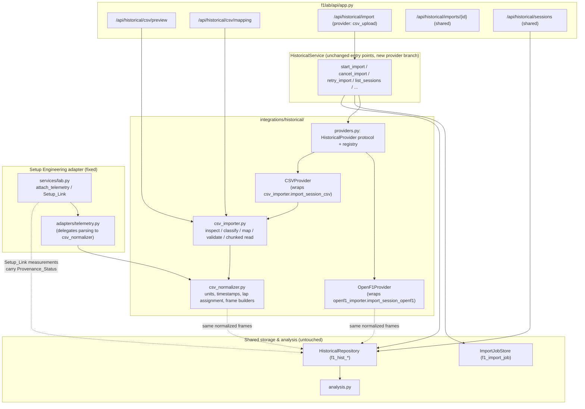

# Design Document

## Overview

Today, `f1lab/integrations/historical/*` imports OpenF1 sessions into the `f1_hist_*` tables, and
`f1lab/adapters/telemetry.py` + `f1lab/services/lab.py` parse Setup Engineering lap-summary CSVs into
TRIALFORGE `Measurement`s with an invented 90-second lap spacing. This feature adds a second Historical
provider, **CSV Upload**, that reuses the OpenF1 provider's pipeline shape (job store, repository,
analysis) instead of growing a second code path, and it fixes the Setup Engineering CSV adapter so it
stops inventing timestamps and fixed `synthetic`/`imported` flags.

Concretely:

- A new `CSVProvider` joins the existing `OpenF1Provider` behind a small `HistoricalProvider` protocol.
  `HistoricalService` drives both through the same `ImportJobStore` and `HistoricalRepository` it already
  uses for OpenF1 — no second job queue, no second session table.
- Two new modules, `csv_importer.py` (inspection, classification, mapping, row validation, chunked
  reading) and `csv_normalizer.py` (units, timestamps, lap assignment, the canonical frame builders),
  live beside `openf1_importer.py` and `openf1_normalizer.py` and are shaped the same way: a pure
  `payload -> manifest + frames` function that `HistoricalRepository.save_session` already knows how to
  persist unchanged.
- `f1lab/adapters/telemetry.py` is rewritten to delegate to `csv_normalizer.py` for parsing, so the Setup
  Engineering CSV path and the CSV Upload provider produce identical normalized output from identical
  input (Requirement 14.2), and so real file timestamps are used instead of a fixed 90 s lap spacing
  (Requirement 14.3/14.4).
- Three new tables (`f1_hist_column_mapping`, `f1_hist_upload`, and a `metadata_json` column on
  `f1_hist_session`) are added by additive migrations so CSV-specific data (column mapping, file hash,
  original filename, confirmed units, free-text metadata with `Unavailable_Marker`s) rides alongside the
  existing `f1_hist_*` schema without touching OpenF1's columns.

### Research: what the existing code already gives us

- **Atomicity and the data-separation guard are already solved.** `HistoricalRepository.save_session`
  (`repository.py:40-62`) deletes any prior row for the session id, writes frames, then flips
  `status='complete'` in one `immediate_transaction`; reads (`manifest`, `_read`) only return rows for
  `status == 'complete'`. `db/guard.py` only allows writes to `HISTORICAL_TABLES` on the engine
  `HistoricalService` uses. The CSV path reuses `save_session` as-is — Requirement 8's atomicity and
  Requirement 1.3's table restriction fall out of reuse rather than new code, provided the new tables are
  added to `HISTORICAL_TABLES`.
- **The job store is already provider-agnostic.** `ImportJobStore` (`jobs.py`) and `dedupe_key` (which
  already prefixes the key with `payload.get('provider') or 'openf1'`) store `request_json` as opaque
  JSON and never branch on provider. `_m008_f1_openf1_only` (migration 8) shows the one place that *did*
  special-case providers (a one-time cleanup when the project dropped FastF1); nothing in today's job
  store assumes `provider == 'openf1'` going forward. Requirement 9.11 is satisfied by construction.
- **`HistoricalImportRequest.provider` is currently `Literal["openf1"]`** (`schemas.py:10`). This is the
  one schema change the unified architecture requires at the request layer; the response/manifest side
  already carries `provider` as a free string (`HistSession.provider: str`, default `"openf1"`,
  `repository.py` manifest `provider=manifest.get("provider", "openf1")`).
- **Frame storage already tolerates provider-specific gaps.** `write_frame`/`read_frame` (`db/frames.py`)
  store exactly the columns a DataFrame has (`schema_of`), so a CSV session that only has
  `speed_kph`/`throttle_pct` naturally stores `NULL` for `gear`/`rpm`/etc. without any new logic — this is
  how Requirement 3.4 ("unmapped field marked unavailable, never a fabricated value") is satisfied for
  telemetry/position/lap frames. Only *session-level* metadata (year, driver, timezone, filename, hash,
  column mapping, units) has no existing home, which is why new tables are needed.
- **The Setup Engineering CSV path's defects are narrow and localized.** `adapters/telemetry.py` has one
  hard-coded assumption to remove: `to_measurements` stamps every lap backwards from `base_time` using
  `timedelta(seconds=90 * (last_lap - rec["lap"]))` (`telemetry.py:84`) and always sets
  `metadata={"synthetic": False, "imported": True, ...}` regardless of the file's real provenance
  (`services/lab.py` never passes a provenance label into `to_measurements`). Requirement 14 is fixed by
  routing `telemetry.py` through `csv_normalizer.parse_csv` for timestamps (so a file with real timestamps
  keeps them, Requirement 14.3) and threading the session's `Provenance_Status` through to
  `to_measurements` so `synthetic`/`imported` are derived, not fixed (Requirement 13.6).
- **TRIALFORGE's `Measurement.metadata` is a free-form dict** (`trialforge/models/core.py:447-467`), so
  `synthetic`, `imported`, `provenance_status`, and `source_session_id` can all be added as metadata keys
  without an SDK change. `is_usable()`/`INVALID_FLAGS` (`measurements/quality.py`) already exclude
  measurements from optimisation when a quality flag like `out_of_range` is present — Requirement 15.7
  ("unverified Setup_Configuration measurements excluded from training observations") reuses this
  mechanism by tagging such measurements with a new quality flag, `unverified_setup`, rather than adding a
  second exclusion path.

### Research: timestamp parsing and unit conversion

- ISO 8601 and `YYYY-MM-DD HH:MM:SS[.fff]` are parsed with `datetime.fromisoformat` (Python 3.11 accepts a
  `Z` suffix only from 3.11 via `datetime.fromisoformat`; we normalize `Z` → `+00:00` before parsing to
  support 3.11 reliably). `HH:MM:SS.fff` (no date) is parsed with `datetime.strptime` against today's date
  in the supplied/default timezone and then converted — this format never carries a date, so the earliest
  timestamp in the file still anchors relative session time (Requirement 5.7) when no absolute date is
  derivable.
- The 1e11 threshold distinguishing epoch seconds from epoch milliseconds (Requirement 5.5) is a widely
  used heuristic: 1e11 seconds is year 5138, so any real epoch-seconds value that small cannot be
  confused with a plausible epoch-milliseconds value (which for the current era is ~1.7e12). This project
  uses the same heuristic already informally used for `session_date` ranges (1950–2100) in Requirement
  7.4, so `1e11` is a safe, documented boundary.
- Unit constants are specified directly in Requirement 5 (1 mph = 1.609344 kph, 1 m/s = 3.6 kph, 1 km =
  1000 m, 1 ft = 0.3048 m) — no external research needed; these match SI/imperial conversion standards.

## Architecture



### Provider interface

```python
# integrations/historical/providers.py
class HistoricalProvider(Protocol):
    name: str                      # "openf1" | "csv_upload"
    source_type: str               # "external_provider" | "user_uploaded"
    def run(self, repo: HistoricalRepository, payload: dict, progress: Progress,
            should_cancel: Callable[[], bool]) -> dict: ...  # returns the manifest dict
```

`OpenF1Provider.run` is a thin wrapper around the existing `import_session_openf1(client, repo, payload,
progress, should_cancel=..., force=...)` — its signature and behaviour do not change (Requirement 1.5).
`CSVProvider.run` wraps a new `csv_importer.import_session_csv(repo, payload, progress, should_cancel)`
that reads the staged upload (see "Uploads and staging" below), classifies, validates, normalizes, and
calls `repo.save_session` — the same call `import_session_openf1` makes at its last line
(`openf1_importer.py:316`). `HistoricalService._run_import` is changed from calling
`import_session_openf1` directly to looking up `PROVIDERS[payload["provider"]].run(...)`; everything else
in `_run_import` (timeout, cancellation, job state transitions) is untouched.

### Uploads and staging

A CSV import is a two-phase HTTP workflow (preview, then start-import) plus an optional later retry, so
the uploaded bytes must be staged somewhere retrievable across requests and across a retry:

- `POST /api/historical/csv/preview` streams the multipart upload to
  `{data_dir}/csv-uploads/{sha256}.csv` (content-addressed: re-uploading the same bytes reuses the file)
  and returns the inspection result keyed by that hash, without creating a session or job (Requirement
  11.1). `data_dir` is the same directory `HistoricalService` already receives for the OpenF1 cache
  (`service.py:46`, `openf1-cache` sibling becomes `csv-uploads`).
- `POST /api/historical/import` with `provider: "csv_upload"` references the file by hash (not by
  re-uploading), together with the confirmed `Column_Mapping`, units, validation policy, and
  `Session_Metadata`. The job payload stores the hash, not the bytes, so `request_json` stays small.
- Retry (Requirement 9.9/9.10) re-reads the file at `{data_dir}/csv-uploads/{sha256}.csv`; if it is
  missing (an operator cleared the directory), `csv_importer.import_session_csv` raises
  `HistoricalImportError(UPLOAD_NOT_FOUND, ...)`, which `_run_import`'s existing `except Exception`
  handler already turns into a `FAILED` job — the API layer additionally rejects the *retry request itself*
  with a clear message before even creating the new job, per Requirement 9.10.
- A new `f1_csv_upload` table (not a `f1_hist_*` table — it has no session yet when a file is only
  previewed) records `{sha256, original_filename, size_bytes, uploaded_at}` so the preview/mapping
  endpoints can be stateless HTTP calls that still share context by hash across requests, and so
  duplicate-file detection by hash (Requirement 10.1-10.2) does not need the file to be re-read from disk.

## Components and Interfaces

### `csv_importer.py`

| Function | Responsibility |
|---|---|
| `inspect(path) -> Inspection` | Column names in file order, total data-row count, first 20 rows (Req 4.1). Reads only the header + first 20 rows plus a full streaming pass for the row count, never loading the whole file into memory for this step. |
| `classify(columns) -> Literal["lap_summary", "sampled_telemetry", "ambiguous", "unrecognized"]` | Case-insensitive/trimmed match against the required Lap_Summary_CSV columns and the time+channel columns of Sampled_Telemetry_CSV (Req 2.1, 3.1, 3.8). |
| `suggest_mapping(columns) -> dict[str, str]` | Case-insensitive/trimmed exact-match suggestion per Standard_Field (Req 4.2). |
| `validate_mapping(mapping, columns) -> MappingResult` | 1:1 checks, unknown-column checks (Req 4.3-4.5). |
| `validate_rows(frame, mapping, units, policy) -> ValidationReport` | Missing-value counts, duplicates, out-of-order, out-of-range, non-numeric, coverage percentages, capped error list (Req 6.*). Delegates numeric/unit/timestamp checks to `csv_normalizer`. |
| `read_chunks(path, chunksize=10_000) -> Iterator[pd.DataFrame]` | `pandas.read_csv(..., chunksize=...)`; bounds peak memory (Req 12.1). |
| `import_session_csv(repo, payload, progress, should_cancel) -> dict` | Orchestrates: load staged file -> classify/validate -> normalize via `csv_normalizer` -> build manifest -> duplicate-session check (Req 10.1-10.3) -> `repo.save_session(...)`. Mirrors `import_session_openf1`'s shape (progress callbacks at the same checkpoints: `PROCESSING` while reading/validating, `SAVING` just before the repository call). |

### `csv_normalizer.py`

| Function | Responsibility |
|---|---|
| `convert_time(value, unit) -> float` / `convert_speed`, `convert_distance` | Pure unit conversion functions (Req 5.1-5.3); each has an exact inverse used by the round-trip property. |
| `parse_timestamp(value, tz_offset, user_tz) -> datetime | None` | The 5-format parser with the 1e11 epoch heuristic and offset/user-tz precedence (Req 5.5-5.8). Returns `None` (never raises) for unparseable values; callers record the row/value in the validation report. |
| `assign_laps(frame, lap_mapping, lap_summary_frame) -> pd.Series` | Lap_number assignment rules (Req 5.9-5.10). |
| `build_lap_frame(rows, mapping) -> pd.DataFrame` | Produces a frame with exactly `LAP_COLUMNS` (from `db/models/f1.py`) — reuses the existing canonical column set so `HistoricalRepository.save_session`'s `_TABLES["laps"]` write path needs no change. |
| `build_telemetry_frame(rows, mapping, units) -> pd.DataFrame` | Produces a frame with exactly `TELEMETRY_COLUMNS`, matching OpenF1's canonical shape so `analysis.py` works unmodified on CSV sessions (Req 1.4, 17.4, 17.8). |
| `build_manifest(session_metadata, mapping, units, file_info, data_type_label) -> dict` | Mirrors `openf1_normalizer.build_manifest`'s shape (`provider`, `source_type`, `verification`, `session_id`, `year`, `event`, ..., plus new keys `column_mapping`, `units`, `file_hash`, `original_filename`, `metadata` with `Unavailable_Marker`s) so `HistoricalRepository.list_sessions`/`manifest()` need no change — they already pass the whole manifest dict through. |

`parse_csv(text, mapping, units, policy) -> ParsedCsv` is the single entry point both the CSV Upload
provider and the rewritten `adapters/telemetry.py` call (Requirement 14.2's "identical normalized output
for identical input" is this literal function-identity, not just equivalent behaviour).

### `adapters/telemetry.py` (rewritten)

```python
def parse_telemetry_csv(text: str, time_unit: str = "s") -> ParsedTelemetry:
    """Delegates to csv_normalizer.parse_csv with the Setup Engineering lap/sector mapping."""
def to_measurements(run_id: str, parsed: ParsedTelemetry, source: str,
                     provenance_status: str) -> list[Measurement]:
    """synthetic/imported are derived from provenance_status (Req 13.6), not fixed.
    Timestamps come from parsed rows; a row with no timestamp gets metadata
    {"timestamp_unavailable": True} and no computed time (Req 14.3/14.4) — no more 90s spacing."""
```

`services/lab.py`'s `attach_telemetry` and `telemetry_preview` pass a `provenance_status` argument
(`"SYNTHETIC DEMO — generated test data"` for files loaded from `/api/demo/*`, `"USER UPLOADED —
UNVERIFIED"` otherwise — the existing demo-vs-upload distinction the frontend already encodes via which
button the user clicked), rather than relying on `to_measurements`'s old constant.

### HTTP API additions (`f1lab/api/app.py`, schemas in `f1lab/api/schemas.py`)

| Endpoint | Request | Response |
|---|---|---|
| `POST /api/historical/csv/preview` (multipart) | file | `{file_hash, columns, row_count, sample_rows, suggested_mapping, detected_type, data_type_choices}` |
| `POST /api/historical/csv/validate` | `{file_hash, mapping, units, metadata, duplicate_policy, order_policy}` | `ValidationReport` (Req 6.12, 6.11) — does not import |
| `POST /api/historical/import` (existing endpoint, extended) | `HistoricalImportRequest` with `provider: "csv_upload"` and a `csv` sub-object `{file_hash, mapping, units, metadata, duplicate_policy, order_policy, data_type}` | existing `ImportJob` view (unchanged shape) |
| `GET /api/historical/csv/session-exists` | `{file_hash, provider, event, session_type, driver, year}` query | `{exists: bool, session_id: str|None}` (Req 10.1-10.2, 11.8) |

All other historical endpoints (`/sessions`, `/sessions/{id}/laps`, `/telemetry`, `/position`, `/compare`,
`/export.csv`, ...) are unchanged — they already key off `session_id`, and a CSV session's `session_id`
is produced by the existing `repository.session_id(year, event, session_type, provider="csv_upload")`
helper, so no new read endpoints are needed (Requirement 11.14).

## Data Models

### Schema changes (additive migrations, appended to `db/migrations/versions.py`)

```python
def _m014_f1_csv_upload(conn):
    create_tables(conn, "f1_csv_upload")      # staged-file registry (sha256, filename, size, uploaded_at)

def _m015_f1_hist_csv_metadata(conn):
    # additive column on the existing table; existing OpenF1 rows get metadata_json = NULL (never read for them)
    conn.exec_driver_sql('ALTER TABLE f1_hist_session ADD COLUMN metadata_json TEXT')
    conn.exec_driver_sql('ALTER TABLE f1_hist_session ADD COLUMN source_type VARCHAR(40)')
    conn.exec_driver_sql('ALTER TABLE f1_hist_session ADD COLUMN verification VARCHAR(20)')
    conn.exec_driver_sql('ALTER TABLE f1_hist_session ADD COLUMN file_hash VARCHAR(64)')
    conn.exec_driver_sql("UPDATE f1_hist_session SET source_type = 'external_provider', verification = 'verified' "
                          "WHERE provider = 'openf1' AND source_type IS NULL")
    create_tables(conn, "f1_hist_column_mapping")   # one row per CSV session: mapping_json, units_json, duplicate_policy, order_policy
```

This satisfies Requirement 1.6 — existing OpenF1 rows are preserved (the `UPDATE` backfills the two new
required-by-Req-1.7 columns for them) and the migration is purely additive (`ADD COLUMN`, `CREATE TABLE
IF NOT EXISTS`), consistent with how migrations 7, 11-13 already add columns/tables without touching
prior data. Both tables and columns are added to `db.guard.HISTORICAL_TABLES` in the same change.

### `db/models/f1.py` additions

```python
class HistSession(Base):
    ...
    metadata_json: Mapped[str | None] = mapped_column(Text, nullable=True)   # Session_Metadata incl. Unavailable_Markers
    source_type: Mapped[str | None] = mapped_column(String(40), nullable=True)
    verification: Mapped[str | None] = mapped_column(String(20), nullable=True)
    file_hash: Mapped[str | None] = mapped_column(String(64), nullable=True, index=True)

class HistColumnMapping(Base):
    __tablename__ = "f1_hist_column_mapping"
    session_id: Mapped[str] = mapped_column(String(200), ForeignKey("f1_hist_session.session_id", ondelete="CASCADE"), primary_key=True)
    mapping_json: Mapped[str] = mapped_column(Text)
    units_json: Mapped[str] = mapped_column(Text)
    duplicate_policy: Mapped[str] = mapped_column(String(30))
    order_policy: Mapped[str] = mapped_column(String(30))

class CsvUpload(Base):
    __tablename__ = "f1_csv_upload"
    file_hash: Mapped[str] = mapped_column(String(64), primary_key=True)
    original_filename: Mapped[str] = mapped_column(String(255))
    size_bytes: Mapped[int] = mapped_column(Integer)
    uploaded_at: Mapped[datetime] = mapped_column(DateTime(timezone=True), default=utcnow)
```

`HistColumnMapping` has an `ondelete="CASCADE"` foreign key to `f1_hist_session` exactly like
`HistFrame`/`HistDataset` already do, so `delete_session` (Requirement 10.7) removes it automatically
with no new deletion code — the mapping disappears in the same `DELETE FROM f1_hist_session` that already
cascades today.

### Standard fields and Unavailable_Marker

`Standard_Field` is exactly the set `TELEMETRY_COLUMNS | LAP_COLUMNS` already defined in `db/models/f1.py`
— no new constant duplicates that list. `Unavailable_Marker` is the Python/JSON value `None` *combined
with* a key in the stored `metadata_json`'s `unavailable` list — plain `None` alone is ambiguous with "not
yet looked at", so `Session_Metadata.unavailable: list[str]` names which of the 11 items are explicitly
marked unavailable (vs. simply missing, which is rejected per Requirement 7.3). Example:

```json
{"provider": "User CSV", "year": 2024, "event": "Imola testing", "circuit": null,
 "session_type": "FP2", "driver": "VER", "session_date": "2024-05-18",
 "timezone": null, "original_filename": "imola_fp2.csv", "time_unit": "s", "distance_unit": "m",
 "unavailable": ["circuit", "timezone"]}
```

## Correctness Properties


*A property is a characteristic or behavior that should hold true across all valid executions of a system—essentially, a formal statement about what the system should do. Properties serve as the bridge between human-readable specifications and machine-verifiable correctness guarantees.*

### Reflection on redundancy

Before finalizing, several prework-identified properties were merged:

- 2.1 (classification) and 4.2 (mapping suggestion) both test case-insensitive/trimmed name matching; kept
  as two properties because they validate different functions (`classify` vs `suggest_mapping`) but share
  one generator strategy.
- 5.1, 5.2, 5.3 (three unit conversions) and 5.11 (the general round-trip requirement) are combined into a
  single parametrized round-trip property (Property 9) covering all three unit families, since they are
  the same mathematical shape (`invert(convert(x)) ≈ x`) differing only in the conversion function and
  constants — one property with a `(field, unit)` generator parameter replaces four.
- 6.7 and 6.9 (policy application) and 6.8 and 6.10 (policy rejection) are combined per-concern
  (duplicates: Property 16; ordering: Property 17) rather than kept as four properties, since "apply policy
  A vs policy B to the same detected issue" is one property about the *pair* of policies, not two
  independent properties.
- 13.1-13.3 (per-source label) and 13.4 (verification default) and 13.5 (demo immutability) are kept
  separate because they are independently falsifiable (a bug in one does not imply a bug in another), but
  13.6 (Setup Engineering adapter flag derivation) is folded into the same property as 13.1-13.3 since it
  is the same provenance-to-flags mapping function applied at a different call site.
- 3.4 and 5.9 (unmapped field / unmapped lap column both "never fabricate a value") are kept as separate
  properties because they apply to different data (any telemetry channel vs. specifically lap assignment)
  with different downstream representations (`NULL` column vs `Unavailable_Marker` metadata item).

### Property 1: Classification is case/whitespace-insensitive and complete

For all sets of column names that are case/whitespace variants of `{lap, sector_1_s, sector_2_s,
sector_3_s}` plus any extra columns, `classify` returns `lap_summary`; for all sets that include a time
column (`timestamp` or `session_time_s`, in any case/whitespace variant) plus at least one telemetry
channel column and do not satisfy the lap-summary column set, `classify` returns `sampled_telemetry`; for
all sets satisfying both column sets, `classify` returns `ambiguous`.

**Validates: Requirements 2.1, 3.1, 3.8**

### Property 2: Required-column rejection names exactly the missing columns

For all subsets `S` of `{lap, sector_1_s, sector_2_s, sector_3_s}` with `S` a proper subset omitted from
the header, validating a Lap_Summary_CSV candidate rejects the file and the reported missing-column list
equals exactly the complement of the present required columns (no more, no fewer).

**Validates: Requirements 2.4**

### Property 3: Optional lap columns round-trip, blanks become null

For all generated lap rows where `lap_time_s`, `driver`, and `sector_4_s` are each independently present
with a value or blank, importing and reading back the stored lap row returns the exact value for a
present non-blank cell and `None` (never `0` or `""`) for a blank cell.

**Validates: Requirements 2.2**

### Property 4: Missing lap_time_s never becomes the sector sum

For all valid Lap_Summary_CSVs where `lap_time_s` is absent from the header, every stored lap has
`lap_time_s = None`, and this holds even when the sector sum for that row, computed independently, would
produce a numeric value — the two must never be conflated.

**Validates: Requirements 2.3**

### Property 5: Invalid lap/sector values are rejected at the first bad cell

For all Lap_Summary_CSVs with exactly one cell replaced by an invalid value (non-positive-integer `lap`;
non-numeric, negative, or zero sector/lap-time), row validation reports the exact 1-based row number and
column name of that cell as the first error, and stores no rows.

**Validates: Requirements 2.5**

### Property 6: A stored Lap_Summary_CSV session has zero telemetry rows

For all valid Lap_Summary_CSVs, after import the session's stored telemetry row count is 0, its
Data_Type_Label is exactly `Lap summaries`, and its reported telemetry channel list is empty.

**Validates: Requirements 2.6, 2.7, 2.8**

### Property 7: Unmapped standard fields are never populated

For all Column_Mappings that omit a given Standard_Field, every sample of the resulting session has that
field stored as `None`, and this holds regardless of what values exist in the raw CSV for a
similarly-named but unmapped column.

**Validates: Requirements 3.4**

### Property 8: Bad or empty mapped-channel cells are stored as missing, never filled

For all generated sample rows where a mapped channel's cell is empty, whitespace-only, or non-numeric, the
stored value for that cell is `None`, and it is never equal to a linear interpolation between, or a copy
of, either neighboring row's value for that channel.

**Validates: Requirements 3.5**

### Property 9: Unit conversion round-trips within tolerance

For all finite non-negative values `v` and all supported units `u` of a field family (time: `s`/`ms`;
speed: `kph`/`mph`/`m/s`; distance: `m`/`km`/`ft`), converting `v` from `u` to the field's standard unit
and then converting the result back to `u` returns a value within a relative tolerance of `1e-9` of `v`.

**Validates: Requirements 5.1, 5.2, 5.3, 5.11**

### Property 10: Timestamp parsing is format-independent

For all instants `t` representable in each of the five supported formats (ISO 8601, `YYYY-MM-DD
HH:MM:SS[.fff]`, `HH:MM:SS.fff` combined with an assumed date, epoch seconds, epoch milliseconds),
formatting `t` into that format and parsing it back with `parse_timestamp` yields the same instant,
including correctly classifying a numeric value below `1e11` as seconds and at or above `1e11` as
milliseconds.

**Validates: Requirements 5.5**

### Property 11: Offset takes precedence over a user-supplied timezone

For all timestamps that carry an explicit UTC offset and all user-supplied IANA timezones, the resolved
UTC instant equals the instant computed from the value's own offset, regardless of what timezone the user
supplied.

**Validates: Requirements 5.6**

### Property 12: No offset and no user timezone yields relative time anchored at zero

For all sample sets whose timestamps carry no offset and for which the user supplies no timezone, the
stored timezone metadata item is the Unavailable_Marker and the minimum stored `session_time_s` across the
set is exactly `0`.

**Validates: Requirements 5.7**

### Property 13: Unparseable timestamps are reported and excluded, never guessed

For all sample sets with exactly one cell holding a value outside all five supported timestamp formats,
the validation result names that row's 1-based number and original value, and that row is absent from the
normalized output.

**Validates: Requirements 5.8**

### Property 14: Lap assignment is never inferred without a source

For all sample sets where `lap_number` is not mapped and no companion Lap_Summary_CSV is supplied for the
session, every sample's stored lap assignment is the Unavailable_Marker.

**Validates: Requirements 5.9**

### Property 15: Mapped lap_number values are assigned verbatim or reported invalid

For all sample sets with a mapped `lap_number` column where some values are integers `>= 1` and others are
not, every valid value is assigned unchanged to its sample, and every invalid value's row number and
original value are reported with that sample's lap assignment left as the Unavailable_Marker.

**Validates: Requirements 5.10**

### Property 16: Duplicate policy outcomes are mutually exclusive and complete

For all sample sets containing at least one group of rows sharing the same (time, lap) pair, applying the
`drop_exact_duplicates` policy to a group whose rows are also identical in every mapped column retains
exactly the first row of that group and reports the rest as dropped; applying the `reject` policy to the
same input blocks the import entirely with that group counted among the reported errors; no third outcome
occurs for either policy.

**Validates: Requirements 6.2, 6.7, 6.8**

### Property 17: Ordering policy outcomes are mutually exclusive and complete

For all sample sets containing at least one adjacent pair within a lap whose time values decrease,
applying the `sort` policy yields a result that is non-decreasing in time within every lap and reports the
count of rows whose position changed; applying the `reject` policy blocks the import entirely, counting
that pair among the reported errors.

**Validates: Requirements 6.3, 6.9, 6.10**

### Property 18: A blocking error always leaves storage unchanged

For all CSV imports whose validation reports at least one blocking error (any combination of missing
required columns, invalid cell values, or a rejected duplicate/ordering policy outcome), the import does
not start, no rows are written for that import, and the returned error list is capped at 200 entries while
the returned total error count equals the true number of blocking errors found.

**Validates: Requirements 6.11**

### Property 19: Coverage percentages are internally consistent

For all validated sample sets, for every Standard_Field, the reported "samples with values" count is
between `0` and the total sample count inclusive, and the reported percentage equals that count divided
by the total, multiplied by 100, rounded to 1 decimal place.

**Validates: Requirements 6.12**

### Property 20: Session metadata validity rules are enforced per item

For all candidate Session_Metadata dicts, an import is rejected and the invalid item is named together
with the rule it violated whenever: year is not an integer in `[1950, 2100]`, session date is not a valid
ISO 8601 calendar date, timezone is not a valid IANA name, a unit is outside the field's supported set, or
a free-text item is empty after trimming or exceeds 200 characters — and for all metadata dicts violating
none of these rules with every one of the 11 items present or explicitly marked unavailable, the import
proceeds and the stored metadata equals the supplied values and markers verbatim.

**Validates: Requirements 7.1, 7.3, 7.4, 7.5, 7.9**

### Property 21: Driver-column filtering is exact and exhaustive

For all sampled rows carrying a `driver` column and a selected driver value, the imported row count equals
the number of rows whose `driver` cell exactly matches the selection, the excluded count equals the
remainder, the two counts sum to the total row count, and a selection matching zero rows rejects the
import entirely with no session created.

**Validates: Requirements 7.6, 7.7**

### Property 22: A failure before the commit point leaves zero rows of that import

For all CSV imports where an exception is injected at any point before the repository's final
`status='complete'` write, the session, its laps, samples, and column mapping are entirely absent from
storage afterward, and every previously stored session is unaffected.

**Validates: Requirements 1.8, 1.9, 8.1, 8.2**

### Property 23: Stored provenance round-trips exactly

For all completed CSV and OpenF1 imports, reading the session back returns `original filename`,
`file hash`, `import date`, `Column_Mapping`, `units`, `Session_Metadata`, `provider`, and `verification`
equal to the values recorded at commit time, and every field the Import_System did not fabricate is either
a verbatim supplied value or an explicit Unavailable_Marker.

**Validates: Requirements 7.8, 8.3**

### Property 24: Duplicate-file and duplicate-key detection is exact

For all pairs of a candidate import and a stored session, if their file hashes are equal, the candidate is
rejected and the existing session's identifier is returned unchanged; if their file hashes differ but
their Session_Metadata keys (provider, event, session type, driver, year) are equal, the candidate is
paused pending a user choice and no stored session changes; if neither match, the candidate proceeds to
normal validation.

**Validates: Requirements 10.1, 10.2, 10.3**

### Property 25: Session replacement and deletion are all-or-nothing

For all sessions undergoing a user-confirmed replacement or a deletion where the storage transaction is
made to fail, the original session and all of its dependent rows across every `f1_hist_*` table are
retained unchanged; for all such operations where the transaction succeeds, the session and every
dependent row (laps, telemetry, position, weather, datasets, column mapping) are completely absent
afterward (for deletion) or fully replaced (for replacement).

**Validates: Requirements 10.5, 10.6, 10.7, 10.8**

### Property 26: Preview never creates a session or job

For all uploaded files, whether structurally valid or invalid, submitting them to the preview endpoint
leaves the set of stored sessions and the set of Import_Jobs unchanged.

**Validates: Requirements 11.1**

### Property 27: File- and row-count limits reject before any row is processed

For all files whose byte size exceeds the configured maximum, or whose row count exceeds the configured
maximum, the importer rejects the file before normalizing any row, names the exceeded limit and its
configured value in the error, and persists no data.

**Validates: Requirements 12.4, 12.5**

### Property 28: Provenance labels and flags are a pure function of source

For all sessions and measurements, `OpenF1_Provider` origin always yields the label `OPENF1 — external
provider`; a non-demo, non-generated CSV upload always yields `USER UPLOADED — UNVERIFIED` with
`verification` left at its unverified default; a demo, generated, or simulator origin always yields
`SYNTHETIC DEMO — generated test data` with `synthetic = true`, and no operation can set `synthetic =
false` on a record whose source is a demo CSV. When the Setup Engineering adapter creates a measurement
from a source carrying the `USER UPLOADED — UNVERIFIED` label, the measurement's `synthetic` is `false`
and `imported` is `true`; from a `SYNTHETIC DEMO` source, `synthetic` is `true` — the same mapping applies
regardless of call site.

**Validates: Requirements 13.1, 13.2, 13.3, 13.4, 13.5, 13.6**

### Property 29: Measurement provenance fields round-trip from their source session

For all measurements created from an imported session, the stored original filename, file hash, Column
Mapping, and units equal those recorded for the source session; if any of these four is unavailable at
creation time, no measurement is persisted and an error names the missing field.

**Validates: Requirements 13.7, 13.8**

### Property 30: Setup Engineering adapter output matches the shared normalizer

For all CSV file contents accepted by both paths, parsing the same bytes through the Setup Engineering
adapter and through the CSV_Provider's normalizer produces identical normalized records (same fields,
same values, same missing-value markers), and for all rows lacking a timestamp in the source file, the
adapter's output marks that row's timestamp as unavailable rather than assigning any computed value
(including the previous fixed 90-second spacing).

**Validates: Requirements 14.2, 14.3, 14.4**

### Property 31: A sector-only file produces no derived channel measurements

For all CSV files containing only lap and sector columns, importing through the Setup Engineering adapter
produces zero measurements with metric `speed_kph`, `rpm`, `brake_pct`, or `stability`.

**Validates: Requirements 14.6**

### Property 32: Setup_Link selection constraints are enforced

For all Setup_Link submissions, the request is accepted only if exactly one driver, between 1 and 100
laps of that driver, between 1 and 50 metrics available for that driver and those laps, and exactly one
target experiment are specified; a metric with no values for the selected driver and laps is never
selectable.

**Validates: Requirements 15.2, 15.3**

### Property 33: Setup_Configuration completeness gates measurement creation entirely

For all Setup_Link submissions, if the Setup_Configuration maps every experiment factor to a value with a
stated verification status, exactly one TRIALFORGE measurement is created for each combination of selected
lap and selected metric, each carrying the session's Provenance_Status; if any factor is missing a value
or a verification statement, zero measurements are created, the target experiment is unchanged, and every
missing factor is named in the error.

**Validates: Requirements 15.4, 15.5, 15.6**

### Property 34: Unverified factor mappings exclude their measurements from training

For all Setup_Link submissions whose Setup_Configuration is not a Verified_Factor_Mapping, the created
measurements are flagged excluded and none of them appear among the observations used for optimisation
training.

**Validates: Requirements 15.7**

### Property 35: Setup_Link measurements carry their source session id

For all measurements created by a Setup_Link import, retrieving that measurement returns the source
session identifier that was used to create it.

**Validates: Requirements 15.8**

## Error Handling

All CSV-specific errors reuse the existing error-code/HTTP-mapping machinery rather than inventing a new
one:

- `HistoricalImportError(code, message)` (already defined in `importer.py`) gains CSV-specific codes
  alongside the existing OpenF1 ones: `INVALID_CSV_STRUCTURE` (missing required columns, ambiguous
  type), `ROW_VALIDATION_FAILED` (blocking row errors, carries the capped error list and total count in
  `message`/a new `.details` attribute), `UPLOAD_NOT_FOUND` (retry with a cleared upload), `DUPLICATE_SESSION`
  (carries the existing session id), `DUPLICATE_KEY_CONFLICT` (needs a user choice), `UNIT_NOT_SUPPORTED`,
  `METADATA_INVALID`. `classify()` in `importer.py` already falls through to `INVALID_REQUEST` for a bare
  `ValueError`, so any new code only needs to be raised as `HistoricalImportError`, not separately wired
  into `classify`.
- These map to HTTP statuses exactly the way `OpenF1Error`/`NotFound`/`Conflict` already do in
  `api/app.py`'s exception handlers (`app.py:112-156`): a `ValueError`/`HistoricalImportError` not caught
  more specifically becomes 422 with `{detail: [{field, message}]}}`; `DUPLICATE_SESSION` and
  `DUPLICATE_KEY_CONFLICT` are raised as the existing `Conflict` type → 409, matching Requirement 11.7's
  "already finished"/"already queued" 409 cases, which reuse the same exception type rather than adding a
  parallel one.
- Request-shape errors (unknown fields, wrong types in the CSV import request body) are caught by
  Pydantic's existing `RequestValidationError` handler (`app.py:112`) and need no new code — Requirement
  11.12's "HTTP 422 listing every invalid field" is exactly what that handler already produces.
- File-too-large (Requirement 11.13) is enforced before Pydantic ever sees the body: the preview endpoint
  checks `request.headers.get("content-length")` (and the actual streamed byte count, since
  `Content-Length` can be absent or wrong) against a configured `CSV_MAX_UPLOAD_BYTES` and raises
  `HTTPException(413)` directly, mirroring how `adapters/telemetry.py` already enforces `MAX_BYTES` for
  the Setup Engineering path.
- Interrupted jobs: `_run_import`'s existing `except Exception` branch, timeout branch, and
  `ImportCancelled` branch are unchanged — a CSV provider failure flows through exactly the same job-state
  transition code OpenF1 failures already use, so Requirement 8.6/9.8 need no new job-state logic, only
  the new error codes feeding into the existing `error`/`error_code` fields.

## Testing Strategy

**Property-based tests** (minimum 100 iterations each, using `hypothesis`, already a test dependency per
`pyproject.toml`'s `test` extra) implement Properties 1-35 above. Each test is tagged:

```python
# Feature: f1-unified-telemetry-import, Property 9: Unit conversion round-trips within tolerance
@given(value=st.floats(min_value=0, max_value=1e6, allow_nan=False, allow_infinity=False),
       field=st.sampled_from(["time", "speed", "distance"]))
@settings(max_examples=100)
def test_unit_round_trip(value, field): ...
```

Generators reuse `hypothesis.strategies` composite builders for a "CSV sample row" and "CSV lap row" so
the ~20 row-level properties (2, 3, 4, 5, 7, 8, 13, 14, 15, 16, 17, 18, 19, 21, 27) share one fixture
module, `tests/csv_strategies.py`, rather than each defining its own ad hoc generator — this keeps edge
cases (blank cells, whitespace-only headers, out-of-range percentages) consistently represented across
properties instead of drifting between tests. State-machine and transaction-failure properties (22, 25)
use `hypothesis.stateful` or targeted monkeypatching of `repo.save_session`/`delete_session` to inject a
failure at a chosen step, following the pattern `tests/test_prop_historical_stability.py` and
`tests/test_historical_repository.py` already use for this codebase's other atomicity tests.

**Unit/example tests** cover what properties cannot: the six specific test cases of Requirement 18.1
(valid lap-summary CSV, valid sampled-telemetry CSV, s/ms timestamps, two alternative timestamp formats,
two timezones, missing channel, duplicates, out-of-order, invalid unit, non-numeric value, max file size),
the lifecycle cases of 18.2 (rollback, cancellation, retry, duplicate rejection, deletion, restart
survival — reusing the restart-recovery pattern already in `test_historical_repository.py` and
`jobs.mark_interrupted`), the OpenF1 regression comparison against `tests/fixtures/phase1_baseline.json`-
style stored baselines (18.3, reusing the existing baseline-fixture convention), and per-provenance-source
assertions (18.5).

**Integration tests** cover the HTTP contract (status codes 404/409/413/422 for each named case in
Requirement 11), CSV session browsing/comparison/chart rendering through the existing `analysis.py` code
path (18.4, asserting literally the same function objects are called for a CSV session as for an OpenF1
session — a `patch`/call-count assertion rather than a timing test), the Setup Engineering attach-refusal
case (18.6), and performance/timing requirements that are not meaningful as 100-iteration PBT (Requirement
12.2 "1,000,000-row import completes in 300s", 12.3 "progress at least every 5%", 12.6 "responds within 2s
while importing", 9.4-9.6 cancellation/progress timing). These reuse the existing `TestClient` fixture in
`tests/conftest.py` and the OpenF1 fakes pattern in `tests/openf1_fakes.py`, adding an analogous
`tests/csv_fixtures/` directory of sample CSVs (valid lap summary, valid sampled telemetry, each
individual error case) generated once and committed, rather than built inline in every test.

**Browser tests** (Requirement 18.8) use Playwright (already a test dependency) to run the six-step
`hist_picker.js` CSV workflow end-to-end against a running app instance with OpenF1 network calls
disabled/unreachable, and separately run an OpenF1 import with no CSV step performed, each asserting
success independently — following the existing pattern in `tests/test_ui_openf1.py` and
`tests/test_frontend_setup_lab.py`, with screenshots captured via Playwright's built-in
`page.screenshot()` at the end of each test per Requirement 18.11.

**Frontend changes are not property-tested** (per the PBT guidance: UI workflow, step gating, and polling
cadence in `hist_picker.js` are example/integration/browser-tested, not amenable to "for all inputs"
properties) — covered instead by the browser tests above plus targeted DOM-assertion tests in the style of
the existing `tests/test_frontend_setup_lab.py`.

`scripts/check-release.sh` is extended with new `pytest_run`/`run` entries for the CSV property suite, the
CSV lifecycle/regression suite, and the CSV browser tests, following the existing convention of one
named check per logical test group (Requirement 18.9-18.10).
