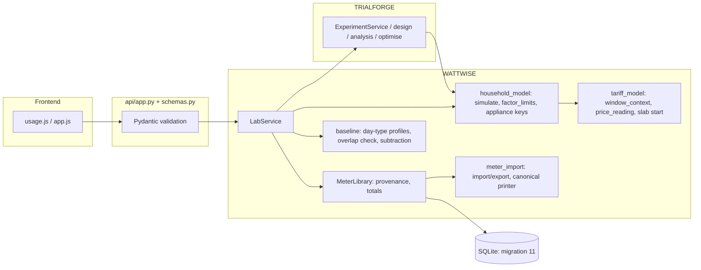
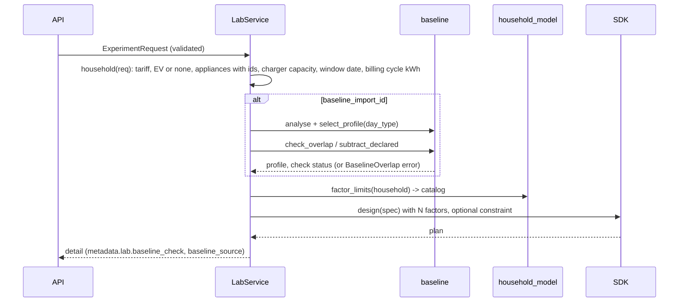

# Design Document

## Overview

This design covers the P0 requirements (1 to 10) and the preservation requirement (16) of the WATTWISE household model improvements. P1 requirements (11 to 15) are not designed here. Section "P1 extension points" only records the seams this design leaves for them.

The design is based on the code as it exists today under `wattwise-lab/backend/wattwise/`:

| File | Current behaviour that matters for this spec |
|---|---|
| `adapters/household_model.py` | Static `FACTORS` dict (3 factors, `charge_power_kw` capped at 11 kW). `simulate()` always has an EV, uses one shared `appliance_start`, and prices each step with `price_at(tariff, abs_hour)`. Pricing context for date-dependent tariffs comes from `TM.simulation_context()`, a single fixed (month, day type) for the whole 16:00-to-16:00 window. |
| `adapters/tariff_model.py` | Date-dependent periods, tiers, `price_interval()`, `bill()`. Tier accumulation always starts at 0 (`cum = 0.0` in `_summarise_extended`). |
| `services/lab.py` | `build_spec()` builds the EV constraint, `departure_charge_pct` measurement and 3 factors unconditionally. `_meter_read()` computes one median interval for the whole file and `_meter_summary()` prices every reading with it. |
| `adapters/meter_import.py` | `interpret()` produces `Reading(start_utc, interval_minutes, kwh, kw, ...)`. Negative non-cumulative values are skipped as "export". No export quantity exists. |
| `services/meter_library.py` | Stores imports in `ww_meter_import` / `ww_meter_reading`. Hard-codes `PROVENANCE = "historical_measured"`. |
| `services/baseline.py` | `analyse()` builds one all-days 96-slot profile (`profile_15min_kw`) and weekday/weekend hourly profiles. `calibration()` has an unused `day_type="all"` parameter. All outputs carry the fixed value `historical_measured`. |
| `api/schemas.py` | `ApplianceIn` has no id. Appliance lists are capped at 6. `charger_power_kw` is "informational" with range (0, 22]. `ev` always has a default object. |
| `frontend/usage.js` | "My usage" screen with `provChip('historical_measured')` on import preview and on the file Detail_Screen. |
| `db/migrations/versions.py` | Append-only list, last migration is 10. |

### Design principles

1. **Additive and default-preserving.** Every new input has a default that reproduces today's behaviour (Requirement 16.6, 16.7). Where a requirement can only be met by changing a default, this design keeps the default and adds an explicit opt-in. These cases are listed under "Requirement clarifications".
2. **Pure core, thin shell.** New logic goes into pure functions in `adapters/` and `services/baseline.py` (no I/O), so it can be property-tested. `LabService` and the API only wire them together.
3. **No TRIALFORGE changes.** All new code lives under `wattwise/`, `db/` migrations and `frontend/`. TRIALFORGE sees only more or fewer `Factor`/`Constraint`/`MeasurementDefinition` objects, which are already generic.

### Research notes

- No external research was needed for the domain logic, which is specified by the requirements and the existing code.
- The only external dependency added is Hypothesis for property tests. It is not installed in `wattwise-lab/.venv` today, and `pyproject.toml` has no entry for it, although a `.hypothesis/` directory exists at the repository root. It is added to the `test` extra.
- SQLite supports `ALTER TABLE ... ADD COLUMN` with a constant default, which is what migration 11 uses ([SQLite ALTER TABLE](https://www.sqlite.org/lang_altertable.html)).

## Architecture



Data flow for creating a study (`LabService.create`):



Layer rule (Requirement 16.3 to 16.5): nothing in this design imports from `wattwise` inside `trialforge`, and no electricity words are added to `trialforge`. The service passes only `Factor`, `Constraint`, `Objective` and `MeasurementDefinition` objects, as it does today.

## Components and Interfaces

### 1. Factor catalog (Requirements 1, 2, 4)

`FACTORS` stays as the static legacy catalog. `/api/meta` keeps returning it unchanged (existing test `test_api_workflow.py:23` asserts the exact key set).

New in `household_model.py`:

```python
CHARGER_MIN_KW = 1.4
CHARGER_MAX_KW = 350.0
DEFAULT_CHARGER_MAX_KW = 11.0
MAX_FLEXIBLE_APPLIANCES = 20

def appliance_key(app: dict) -> str:            # "appliance_start__" + token(app["id"])
def appliance_id(name: str, explicit: str | None) -> str   # slug of name when no explicit id

def factor_limits(charger_capacity_kw: float | None,
                  appliances: list[dict] | None = None,
                  has_ev: bool = True) -> dict[str, dict]:
    """Return the factor catalog valid for one household. No arguments beyond defaults returns a copy of FACTORS."""

def baseline_setup(household: dict) -> dict[str, float]:
    """BASELINE with charge_power_kw clipped to the charger capacity (7.4 -> min(7.4, capacity))."""
```

`factor_limits` rules:
- EV present: `charge_start` as today. `charge_power_kw` is `[1.4, capacity]` when a capacity is given, else `[1.4, 11.0]`.
- No EV: `charge_start` and `charge_power_kw` are omitted.
- Legacy `appliance_start` is always present, so old requests and stored runs stay valid.
- One `appliance_start__<token>` entry per flexible appliance, same limits as `appliance_start` (17 to 30 h), label `"Start: <name>"`.

Every place that reads `FACTORS` by factor name switches to the household-specific catalog: `LabService.build_spec`, `LabService._summary`, `MeterSimulatorAdapter.__init__`/`validate`, `ExperimentRequest._factors_ok`, `DayRequest` setup validation (`LabService.day`), and `narrative.schedule_text`.

### 2. Charger capacity (Requirement 1)

- **Schema.** `HouseholdSettings.charger_power_kw` is widened from `(0, 22]` to `[1.4, 350]` with at most 2 decimals and stays the stored Charger_Capacity. `ExperimentRequest` and `DayRequest` gain `charger_capacity_kw: float | None`. A shared validator `validate_charger_capacity(value)` rejects bools and strings, values below 1.4, above 350, and with more than 2 decimals (checked with `Decimal(repr(v)).as_tuple().exponent >= -2`). Messages:
  - below 1.4: `charger capacity 1.0 kW is below the minimum supported value of 1.4 kW`
  - other: `charger capacity <value> is invalid; accepted range is 1.4 kW to 350 kW with at most 2 decimal places`
  Because Pydantic rejects the request before `HouseholdStore.put` runs, the stored configuration is unchanged (1.3, 1.4).
- **Reading old stored settings.** `HouseholdStore.get()` currently re-validates stored JSON. Existing rows may hold a value in (0, 1.4). On read, an out-of-range stored value is treated as `None` and a `notice` is added to the response. It is never raised. Validation applies to writes only.
- **Default factor range.** When a request does not set `factors` explicitly (`"factors" not in model_fields_set`) and has a capacity, `charge_power_kw` is `[1.4, capacity]`. When a request sets ranges explicitly, they must lie inside `[1.4, capacity]`; the existing "range must lie within" error is reused with the capacity-specific limits.
- **Model check.** `simulate()` raises `ChargerCapacityError(ValueError)` when `setup["charge_power_kw"] > household["charger_capacity_kw"]`: `charging power 9.0 kW exceeds the charger capacity 7.4 kW`. No computation happens before the check. The check runs only when the household carries a capacity, so households without one behave as before. The adapter's `validate()` uses the same catalog, so a run configuration above capacity fails validation.
- **Baseline setup.** `BASELINE["charge_power_kw"]` is 7.4. For capacities below 7.4 the baseline schedule would trip the check, so every internal `simulate(BASELINE, hh)` call uses `baseline_setup(hh)` instead. Call sites: `LabService._summary`, `LabService.overview`, `LabService.day`, `LabService.run_profile`, `comparison.build`, `narrative.recommendation`.
- **Level generation.** Levels are produced by the SDK from `Factor.lower/upper`, so bounding the factor bounds the levels (1.7).

### 3. Households without an EV (Requirement 2)

- **Schema.** `ev: EVSettings | None = Field(default_factory=EVSettings)` on `HouseholdSettings`, `ExperimentRequest`, `DayRequest`. A request that omits `ev` gets the default EV (unchanged). An explicit `"ev": null` means no EV.
- **Validation.** A model validator rejects `ev is None` with no flexible appliance: `at least one optimisable load is required: add a flexible appliance or an EV`. It runs in the schema layer so nothing is stored (2.4).
- **Household dict.** `household["ev"]` is `None` when there is no EV.
- **`simulate()`.** With `ev is None`, `ev_kw = 0.0` at every step, no `soc` tracking, and `metrics` omit `departure_charge_pct` and report `ev_energy_kwh = 0.0`. `charge_start` and `charge_power_kw` in `setup` are ignored if present.
- **`LabService.build_spec`.**
  - EV factors are skipped when there is no EV, including when the default `factors` dict contains them.
  - The `departure_charge_pct` constraint is not added, and `measurement_definitions(has_ev=False)` omits that metric.
  - If after this fewer than two factors remain and the method is not `ofat`, the method is set to `ofat` and `metadata.lab.notes` records `design method changed to ofat: only one factor`. This keeps 2.1 working for a household with one flexible appliance. It must be confirmed against the SDK in the first implementation test, because `ExperimentRequest._factors_ok` has the "at least two factors" rule for a reason that lives in the SDK.
  - `metadata.desired_charge_pct` is `None`.
- **Adapter.** `_measure()` writes only the metric keys present in `sim["metrics"]`.
- **Other readers of EV metrics.** `narrative.recommendation` and `comparison.build` read `departure_charge_pct`; both use `.get()` and omit the EV rows when the household has no EV.

### 4. Provenance labels (Requirement 3)

- **Constants** (in `meter_library.py`): `PROVENANCE_LABELS = ("real_meter", "synthetic_demo", "unknown")`.
- **`normalize_provenance(value) -> str`** returns `"unknown"` for `None`, `""` or whitespace-only; returns the stripped value if it is one of the three labels; otherwise raises `ProvenanceError` with message `provenance must be one of real_meter, synthetic_demo, unknown (got '<value>')`. The check happens before any database write, so a rejected import stores nothing (3.9).
- **API.** `MeterImportRequest.provenance: str | None = None`. `MeterLibrary.import_csv(..., provenance=None)`. `MeterLibrary._view` returns `provenance` as the label.
- **Storage.** Migration 11 adds `ww_meter_import.provenance VARCHAR(20) NOT NULL DEFAULT 'unknown'`. Existing rows get `unknown` and no other column changes (3.8). `_view` also treats a NULL as `unknown`.
- **Demo file.** The "Use demo file" buttons in `usage.js` send `provenance: "synthetic_demo"`. The server does not guess from file content, so an API client that uploads the demo CSV without a label gets `unknown`. This follows 3.2.
- **Result provenance (3.7).** Result objects keep their current `provenance` key (see clarification C1) and gain `source_label`, set from the file's label. `baseline.analyse(..., source_label=None)`, `baseline.calibration(...)`, `comparison.build` and `meter_library.preview` pass it through. `meter_library.preview` returns `provenance: "unknown"`-style label only after import; before import it returns `source_label: null` and no fixed value.
- **Badges.** A backend function `provenance_badge(label) -> {"text", "css"}` returns `MEASURED` / `prov-m` for `real_meter`, `SYNTHETIC DEMO` / `prov-s` for `synthetic_demo`, `UNVERIFIED SOURCE` / `prov-u` for `unknown`. `/api/meta` exposes the table as `provenance_badges`. `usage.js` renders exactly one badge from it on the Detail_Screen and on the import preview, and `style.css` gets `.prov-u`. The existing `historical_measured*` chips used for quantity kinds in comparison tables stay, but when the file's `source_label` is not `real_meter` the `MEASURED` text is replaced by the label's badge text.

### 5. Independent appliance start times (Requirement 4)

- **Schema.** `ApplianceIn.id: str | None` with pattern `^[a-z0-9][a-z0-9_-]{0,38}$`. When absent, the id is the slug of `name`. `max_length` of appliance lists rises from 6 to 20 on `HouseholdSettings`, `ExperimentRequest` and `DayRequest`.
- **Validation** (`validate_appliances(apps)`, shared by the three schemas): more than 20 flexible appliances: `at most 20 flexible appliances are supported (got N)`; duplicate resolved ids: `duplicate appliance id '<id>'`. Factor tokens replace `-` with `_`, and uniqueness is checked on the token, so `a-b` and `a_b` collide and are rejected.
- **Opt-in mode.** `ExperimentRequest.appliance_start_mode: Literal["shared", "per_appliance"] = "shared"`.
  - `shared` (default): today's behaviour, one `appliance_start` factor. This keeps `test_api_workflow` expectations (it asserts `appliance_start` is in run configurations and in `/api/meta`).
  - `per_appliance`: the `factors["appliance_start"]` entry is a range template. `build_spec` creates one `Factor` named `appliance_start__<token>` per flexible appliance with that range (or an explicit `factors["appliance_start__<token>"]` override). Result: exactly N factors (4.1), unique derived names (4.3).
- **`simulate()`.** Start time of a flexible appliance is `setup.get(appliance_key(app), setup.get("appliance_start", default))`. Each step also records `by_appliance: {id: kw}` so tests can check independence (4.5, 4.9). The existing `appliances` total column is unchanged.
- **Legacy and conflict (4.7, 4.8).** `check_setup_keys(setup)` raises `FactorConflict` (`setup contains both 'appliance_start' and per-appliance start factors: <keys>`) when both forms are present. It is called from `LabService.day` (via `DayRequest` validation), `MeterSimulatorAdapter.validate` and `LabService.create` for explicit factor dicts that contain both `appliance_start` enabled and per-appliance keys outside `per_appliance` mode. The error is raised before any store write.
- **One appliance (4.6).** With one flexible appliance, `appliance_start__x = v` and legacy `appliance_start = v` produce the same steps, since both resolve to the same start time.

### 6. Day-type baseline profiles (Requirement 5)

In `baseline.py`:

```python
class NoCompleteDay(ValueError): ...
class InvalidDayType(ValueError): ...

def day_type_of_date(d: date) -> str            # weekday() >= 5 -> "weekend"   (local date of the file's zone)
def profiles(per_day_slots, complete_days) -> dict   # {"all": [96], "weekday": [96]|None, "weekend": [96]|None}
def select_profile(analysis: dict, day_type: str | None) -> dict
```

- `analyse()` now also returns `profiles` (`all`, `weekday`, `weekend`, each 96 values or `None`) and `day_counts`. The existing keys (`profile_15min_kw`, `weekday_hourly_kw`, ...) are untouched.
- **Slot value.** For one complete day and slot k, the value is `kWh in slot / hours covered`. A day type profile slot is the mean of those values over the complete days of that type that have the slot (5.1). The all-days profile uses the same rule over all complete days. Today's `profile()` divides total energy by total covered minutes, which weights days by coverage; the new rule is the per-day mean the requirement states. `profile_15min_kw` keeps the old computation so `calibration()` results and existing tests do not move when no day type is requested.
- **`select_profile(analysis, day_type)`**:
  - `day_type not in (None, "weekday", "weekend")` raises `InvalidDayType` (5.6).
  - `days_complete == 0` raises `NoCompleteDay` (5.4).
  - Day type with at least 1 complete day returns that profile with `{day_type_used, requested, days_used, fallback: False}` (5.2).
  - Day type with 0 complete days returns the all-days profile with `fallback: True` (5.3).
  - `None` returns the legacy all-days profile with `day_type_used: "all"`. This is the default, so old requests are unchanged.
- **Wiring.** `ExperimentRequest.day_type: Literal["weekday","weekend"] | None = None` and `DayRequest.day_type` likewise. `LabService.calibration(import_id, day_type)` calls `select_profile` and returns the metadata in `hh["baseline_source"]` (5.7). The string is passed unchanged. This `day_type` is independent of the tariff's `simulation_day.day_type`, which keeps controlling tariff pricing when no window date is supplied.

### 7. Midnight crossing in tariff context (Requirement 6)

- **Window start date.** `ExperimentRequest.window_start_date` and `DayRequest.window_start_date` are optional ISO dates, copied to `household["window_start_date"]` and stored in the spec metadata.
- **Reference date.** When no date is supplied, the Household_Model derives one from the tariff's `simulation_day`: `reference_date(month, day_type)` returns a date in that month that is a Tuesday for `weekday` and a Saturday for `weekend`, never the last day of the month. For both choices the next calendar day has the same day type and month, so results are identical to the old fixed context (6.6). When the tariff is not date-dependent, no date is needed and prices do not depend on it.
- **Tariff Model API** (`tariff_model.py`):

```python
class MissingStartDate(ValueError): ...

@dataclass(frozen=True)
class WindowContext:
    start_date: date
    def for_hour(self, abs_hour: float) -> tuple[int, str]:
        d = self.start_date + timedelta(days=int(abs_hour // 24))
        return d.month, day_type_of(d)

def window_context(tariff, start_date: date | None) -> WindowContext | None:
    """None for tariffs that are not date dependent. Raises MissingStartDate for date-dependent tariffs when start_date is None."""
```

- **Household Model.** `price_at`, `period_label` and `summarise` take an optional `ctx: WindowContext | None`. With `ctx=None` they behave exactly as today (`simulation_context`). `simulate()` builds `ctx = window_context(tariff, household_start_date or reference_date(...))` and passes it for every step, so steps with `abs_hour >= 24` use the next day's month and day type (6.1 to 6.5). `_summarise_extended` takes the same `ctx` and calls `price_interval(..., month, day_type)` per reading.
- **Missing date (6.7).** `window_context` is the only place that decides, and the Household_Model always supplies a date (explicit or derived). A caller that calls `window_context(date_dependent_tariff, None)` directly gets `MissingStartDate: tariff '<name>' is date dependent and needs the simulated window's start date`, and no costs are returned.

### 8. Billing-cycle context for slab tariffs (Requirement 7)

- **Input.** `billing_cycle_consumption_kwh: float | None` on `ExperimentRequest` and `DayRequest`, validated by `validate_billing_consumption(v)`: numeric (not bool), `0 <= v <= 1_000_000`, at most 3 decimals. Error: `billing cycle consumption must be a number from 0 to 1,000,000 kWh (got <v>)`. It is stored in `household["billing_cycle_kwh"]` (default 0.0).
- **Pricing.** `_summarise_extended` starts `cum` at `billing_cycle_kwh` when the tariff has tiers and `tier_basis == "billing_period"`. For `daily` basis the thresholds apply to the day's own energy, so the value is not used (see C5). Tariffs without tiers ignore the value (7.5). No value means 0.0 (7.3).
- **Default from the meter library (7.6, 7.7).** `baseline.billing_cycle_default(readings, tz, day) -> dict`: sum of `kwh` of readings whose local date is in the same calendar month as `day` and earlier than `day`. The billing cycle is the calendar month (see C5). Returns `{kwh, notice}`. `kwh = 0.0` with a notice when no earlier reading exists in the cycle, or when the file cannot be read (`LabService` catches the read error). New endpoint `GET /api/meter/imports/{id}/billing-cycle-default?day=YYYY-MM-DD`. The study form shows the value in an editable field.

### 9. Interval-aware meter reading costs (Requirement 8)

New pure function in `tariff_model.py`:

```python
@dataclass(frozen=True)
class Slice:
    start: datetime; seconds: float; kwh: float; label: str; charge: float; credit: float

def price_reading(tariff, start_local: datetime, duration_s: float, kwh: float,
                  cum_import_kwh: float = 0.0, *, use_real_dates: bool = False) -> list[Slice]:
    """Split one reading at every tariff period boundary (and local midnight) inside [start, start+duration)
    and price each slice with price_interval(). Slice energy = kwh * slice_seconds / duration_s."""
```

- Boundaries are the local wall-clock hours of all period starts and ends plus 00:00, converted with `zoneinfo`, so DST days stay correct.
- `use_real_dates=False` keeps today's meter pricing context (`simulation_context`) so that costs for data that does not cross a boundary are identical to now (8.5, see C9). Real-date pricing is available behind the flag for later.
- `LabService._meter_summary` is rewritten to loop over readings, each carrying its own `interval_minutes` (from the importer's `Reading`), and to aggregate slices into the same output keys as before (`energy_kwh`, `energy_cost`, `energy_charge`, `demand_charge`, `peak_power_kw`, `cost_by_period`, `hourly_profile`). The median-interval computation (`statistics.median(deltas)`) is no longer used to price anything. It stays only as the check for the 60-minute maximum and as the SDK series sampling interval, which is a preview-chart concern.
- **Simple CSV path.** `parse_meter_csv` has no interval column. `LabService._meter_read` converts its readings to `Reading` objects with the file's typical interval, as `interpret()` already does for power files. Mixed intervals therefore only occur through the library interpreter (cumulative registers).
- **Non-positive interval (8.4).** `meter_import.interpret()` gets a final validation pass: any reading with `interval_minutes <= 0` or non-finite is removed and logged as `skipped` with reason `interval duration <= 0 at <timestamp>`; the other readings are returned unchanged. A configured `interval_minutes <= 0` stays a file-level error as today.
- **Gaps (8.6).** Each reading is priced for `[start, start + interval)` only. Nothing is priced between readings.

### 10. Solar export ingestion (Requirement 9)

- **Importer.** `Reading` gets two trailing fields with defaults: `export_kwh: float = 0.0`, `export_kw: float = 0.0`. `kwh` and `kw` remain the import quantities, so all existing positional constructors and consumers (`baseline`, `meter_library.readings`) keep working. `ImportOptions` gets `export_column: str | None = None` and `signed: bool = False`.
- **Modes.**
  - *Legacy* (neither option): unchanged, including skipping negative rows.
  - *Separate columns* (`export_column` set; `value_column` is the import column): both read per row, same unit and reading kind. Supported for `power` and `interval_energy`.
  - *Signed* (`signed=True`): positive values become import, the absolute value of negative values becomes export.
  - Export or signed with `reading_kind == "cumulative"` raises `MeterImportError("export is not supported for cumulative registers")`.
  - Import-only files in any mode get `export_kwh = 0` (9.3).
- **Strict mode (9.4, 9.5).** In separate-columns and signed modes, a negative value in an import or export column, or a non-numeric one, raises `MeterImportError("row <line>, column '<name>': <reason>")` for the first offending value. `interpret()` raises before returning readings, so `MeterLibrary.import_csv` stores nothing. Legacy mode keeps its lenient row-skipping (see C6).
- **Library.** Migration 11 adds `ww_meter_reading.export_kwh REAL NOT NULL DEFAULT 0`, `export_kw REAL NOT NULL DEFAULT 0`, and `ww_meter_import.total_import_kwh`, `total_export_kwh` (REAL, backfilled by `UPDATE ... SET total_import_kwh = (SELECT SUM(energy_kwh) ...)`, export 0). `import_csv` writes them; `_view` returns both totals (9.6). Files without export return unchanged readings with `total_export_kwh = 0` (9.8).
- **Baseline.** `baseline.analyse` already uses `r.kwh`/`r.kw` only, so the Baseline_Load excludes export (9.7). `_split_local` is unchanged.
- **Canonical format.** `meter_import.format_canonical(readings) -> str` writes `timestamp,interval_minutes,import_kwh,export_kwh` with 6 decimals and UTC `Z` timestamps. `CANONICAL_OPTIONS` is the `ImportOptions` that re-reads it (`reading_kind="interval_energy"`, `unit="kWh"`, `export_column="export_kwh"`, `timezone="UTC"`). `parse(format(parse(x)))` has the same count, order, timestamps and quantities (9.10, 9.11).

### 11. Baseline double-counting validation (Requirement 10)

In `baseline.py`, all pure:

```python
def quarter_hour_series(readings, tz) -> list[tuple[datetime, float | None]]   # contiguous local 15-min slots, None for gaps
def check_overlap(series, modelled: list[ModelledLoad]) -> list[str]           # names of overlapping appliances
def subtract_declared(profile96, declared: list[ModelledLoad]) -> SubtractionResult
```

- `ModelledLoad(name, power_kw, steps)`: a rectangular load of `power_kw` for `steps` quarter-hours. Flexible and fixed appliances use `power_kw` and `ceil(duration_h / 0.25)`. The EV uses the charger power at the baseline setup and `ceil(energy_to_charge / (power * efficiency) / 0.25)`.
- **Detector (10.1, 10.2).** For each modelled load of length L, over the quarter-hour series with prefix sums: the *rise* at position i is `mean(series[i:i+L]) - mean(series[i-L:i] + series[i+L:i+2L])` (windows containing a gap are skipped). The load counts as present when at least `OVERLAP_MIN_OCCURRENCES = 3` non-overlapping positions have `rise >= OVERLAP_RISE_FRACTION * power_kw` with `OVERLAP_RISE_FRACTION = 0.8`. Cost is O(n) per appliance, so one year (35,040 slots) and 20 appliances is under one million window evaluations. The thresholds are module constants and are recorded in the check result so users can see them.
- **Study flow in `LabService.create`:**
  1. No `baseline_import_id`: the baseline is synthetic and not from meter data. Status `not_applicable` (see C10), appliances checked recorded.
  2. Import has no readings or no quarter-hour data: `BaselineUnavailable("baseline is unavailable: ...")`, study blocked (10.7).
  3. `baseline_excludes_modelled_appliances: true` in the request: check skipped, status `skipped` and `skipped_by_user_confirmation: true` (10.3).
  4. Appliances declared `in_baseline: true` (new field on `ApplianceIn`, and on `EVSettings`): `subtract_declared` runs, status `subtracted`, appliance names recorded (10.4, 10.6).
  5. Otherwise `check_overlap` on all modelled loads that were not declared. Any hit raises `BaselineOverlap` naming every appliance, status `blocked`, nothing is stored (10.2). No hit gives `passed`.
- **Subtraction (10.4, 10.5, 10.8).** The modelled load of a declared appliance is taken at its baseline schedule: a fixed appliance at `fixed_start`, a flexible appliance at the baseline `appliance_start` default, the EV from `simulate` under `baseline_setup(hh)` with a zero base profile. It is subtracted from the 96-step window profile at each step. Values below zero are set to 0 and the count and clock times of clipped steps are returned in `{"clipped": {"count", "times"}}`.
- **Record.** `spec.metadata["lab"]["baseline_check"] = {status, appliances_checked, appliances_subtracted, skipped_by_user_confirmation, thresholds, clipped}` and it is returned in `detail()`.
- **API errors.** `BaselineOverlap`, `BaselineUnavailable`, `ProvenanceError`, `FactorConflict`, `ChargerCapacityError`, `MissingStartDate` map to HTTP 422 in `api/app.py` next to the existing `TariffError` handling.

### 12. Frontend (Requirements 3, 7)

- `usage.js`: a provenance `<select id="u-prov">` (options: unspecified, real meter, synthetic demo, unknown) in the import form; sent as `provenance`. Demo buttons set `synthetic_demo`. Detail_Screen and preview use `META.provenance_badges[label]`.
- `app.js` / study form: charger capacity field, "I have no EV" toggle, appliance id column, day type select, window start date, billing cycle consumption field with its default and notice, "baseline excludes modelled appliances" confirmation, and the per-appliance start mode select. No new screens.

### 13. Migration 11

`_m011_ww_provenance_and_export(conn)` appends `Migration(11, "wattwise meter provenance and solar export", ...)`. It runs the four `ALTER TABLE ... ADD COLUMN` statements guarded by a `PRAGMA table_info` check (so it is safe on fresh databases where `create_tables` already built the new model), then the totals backfill. The ORM models in `db/models/wattwise.py` get the same columns. Migration 6 is not edited.

### P1 extension points (not implemented)

- Operating windows (R11): `factor_limits` already takes the appliance dicts, so per-appliance start ranges can be narrowed there.
- Multiple EVs (R12): `household["ev"]` can become a list behind the same `has_ev` check.
- Solar and battery (R13): `Reading.export_kwh` and `Slice.credit` already carry export.
- Multi-day (R14): `WindowContext(start_date)` and `billing_cycle_kwh` are the two inputs a day loop must advance.
- Multi-objective (R15): objective construction stays in `build_spec`.

## Data Models

### Request and settings (Pydantic, `api/schemas.py`)

| Model | New or changed fields |
|---|---|
| `ApplianceIn` | `id: str \| None`, `in_baseline: bool = False` |
| `EVSettings` | `in_baseline: bool = False` |
| `HouseholdSettings` | `ev: EVSettings \| None`, `charger_power_kw` range `[1.4, 350]`, 2 dp (write-time), `appliances` max 20 |
| `ExperimentRequest` / `DayRequest` | `ev: EVSettings \| None`, `charger_capacity_kw`, `appliance_start_mode` (experiment only), `day_type`, `window_start_date`, `billing_cycle_consumption_kwh`, `baseline_excludes_modelled_appliances` (experiment only), `appliances` max 20 |
| `MeterImportRequest` | `provenance: str \| None` |

Household dict stored in `spec.metadata["lab"]["household"]` (new keys are optional, absent means old behaviour):

```json
{
  "ev": {"battery_kwh": 60, "...": "..."} ,
  "tariff": {"...": "..."},
  "appliances": [{"id": "dishwasher", "name": "Dishwasher", "power_kw": 1.1, "duration_h": 2.0, "flexible": true, "fixed_start": 20.0}],
  "base_load_kw": 0.35,
  "charger_capacity_kw": 7.4,
  "window_start_date": "2026-03-06",
  "billing_cycle_kwh": 120.5,
  "base_profile_kw": [ "96 values" ],
  "baseline_source": {"import_id": "...", "day_type_used": "weekend", "requested": "weekend", "days_used": 4, "fallback": false, "source_label": "real_meter"},
  "baseline_check": {"status": "passed", "appliances_checked": ["EV", "Dishwasher"], "appliances_subtracted": []}
}
```

Stored studies from before this change have none of the new keys. `simulate()` and `LabService` treat every missing key as the default that reproduces old behaviour (16.6, 16.7). Per-appliance ids for old stored appliances are derived on read with `appliance_id(name, None)`.

### Database (migration 11)

| Table | Column | Type | Default |
|---|---|---|---|
| `ww_meter_import` | `provenance` | VARCHAR(20) NOT NULL | `'unknown'` |
| `ww_meter_import` | `total_import_kwh` | REAL | backfilled sum of `energy_kwh` |
| `ww_meter_import` | `total_export_kwh` | REAL | 0 |
| `ww_meter_reading` | `export_kwh` | REAL NOT NULL | 0 |
| `ww_meter_reading` | `export_kw` | REAL NOT NULL | 0 |

### In-memory types

- `Reading` (+ `export_kwh`, `export_kw`), `ImportOptions` (+ `export_column`, `signed`).
- `WindowContext(start_date)`, `Slice`.
- `ModelledLoad(name, power_kw, steps)`, `SubtractionResult(profile, clipped_count, clipped_times)`.

### Requirement clarifications

These are places where a literal reading of a requirement conflicts with another requirement or with the existing code. The design takes the choice shown. Each should be confirmed before implementation.

- **C1. Requirement 3.7 vs Requirement 16.1.** Existing tests assert `provenance == "historical_measured"` for files imported without a label (`test_baseline_and_comparison.py:42, 103-104`, `test_meter_library.py:130`). Those files would now be `unknown`. Setting `provenance` to the file label would fail those unmodified tests. Design: the existing `provenance` key keeps describing the *kind* of quantity (measured, measured and priced, projected), and the new `source_label` carries the file's label. The UI shows the label. Recommended wording change for 3.7: "attach `source_label`" instead of "set the result's provenance".
- **C2. Requirement 2.6.** The simulation also contains non-flexible appliances. The property uses base load plus all appliance energy, not only flexible appliance energy.
- **C3. Requirement 4.1 vs 16.6.** Existing tests create experiments with the default `appliance_start` factor and two flexible appliances. Per-appliance factors are therefore opt-in via `appliance_start_mode`, and the default stays `shared`.
- **C4. Requirement 5.8.** With slots missing on some complete days, the weights are the per-slot counts of contributing days, which equal the complete-day counts when no slot is missing.
- **C5. Requirement 7.** (a) The value only affects tariffs with `tier_basis == "billing_period"`; daily-basis tiers restart each day. (b) The billing cycle is the calendar month of the optimisation day because the tariff model has no cycle start date. (c) Requirement 7.8 only holds when tier adders do not decrease with higher tiers. The schema allows decreasing adders (range -10 to 10). The property is stated for non-decreasing adders.
- **C6. Requirements 9.4 and 9.5.** Rejecting the whole file on a negative or non-numeric value applies in separate-column and signed modes. Legacy single-column imports keep skipping bad rows, because existing importer tests depend on that.
- **C7. Requirement 1.** A capacity of exactly 1.4 kW gives a zero-width range. The charging power factor is then left out of the design and fixed at 1.4 kW. Stored legacy values below 1.4 are read as "not set".
- **C8. Requirement 6.7.** The rejection is in `window_context`. The Household_Model always supplies a date (explicit or derived from `simulation_day`), so normal studies never hit it.
- **C9. Requirement 8.5.** The meter pricing context today is the tariff's `simulation_day`, not the readings' real dates. To keep results identical, `price_reading` defaults to that context (`use_real_dates=False`).
- **C10. Requirement 10.6.** A synthetic (non-meter) baseline has nothing to check. Its status is `not_applicable`, a fifth value beyond the four listed.
- **C11. Requirement 4.2.** Raising the appliance list cap from 6 to 20 is a schema change. If an existing test asserts that 7 appliances are rejected it will need review, which Requirement 16.1 forbids. No such test was found in the files read.
- **C12. Requirement 10.2 vs 16.1.** The fixtures of `test_experiment_from_calibrated_baseline_and_comparison` and `test_measured_schedule_is_labelled_measured` (`known_csv()` in `tests/test_baseline_and_comparison.py`) contain a 3 kW weekday 18:00-20:00 load step that matches modelled appliances, so the overlap check would reject them. These two tests set `baseline_excludes_modelled_appliances=true` in the experiment request. This is the one documented exception to 16.1.

## Correctness Properties

*A property is a characteristic or behavior that should hold true across all valid executions of a system-essentially, a formal statement about what the system should do. Properties serve as the bridge between human-readable specifications and machine-verifiable correctness guarantees.*

Reflection on redundancy: criteria that test the same function with the same input generator were merged (1.1/1.3/1.4, 7.1/7.4, 9.4/9.5, 4.1/4.3). Backward-compatibility criteria (2.5, 4.6, 6.6, 7.3, 7.5, 8.5, 9.8, 16.6, 16.7) share one model-based property. Weighted-mean 5.8 stays separate from 5.1 because it relates two profiles rather than checking one. Requirements 10.1 (timing), 2.1 (end-to-end), 3.3, 5.7, 6.1, 6.4, 6.5, 10.3, 10.6, 16.1 to 16.5 are example, integration or smoke tests and have no property.

### Property 1: Charger capacity validation

*For any* input value, the capacity validator accepts it if and only if it is a number between 1.4 and 350 inclusive with at most 2 decimal places. For every rejected value the error names the charger capacity and the submitted value, states the 1.4 kW minimum when the value is below 1.4 and the 1.4 to 350 kW range otherwise, and the stored household configuration is unchanged.

**Validates: Requirements 1.1, 1.3, 1.4**

### Property 2: Charging range follows capacity

*For any* valid charger capacity C, the charging factor limits are lower 1.4 and upper C, and every level generated across that range lies within 1.4 and C inclusive. *For any* household without a capacity, the limits are 1.4 and 11.

**Validates: Requirements 1.2, 1.6, 1.7**

### Property 3: Over-capacity charging power is rejected

*For any* charger capacity C and charging power P, the household model raises an error stating P and C and returns no result when P is greater than C, and returns a result when P is less than or equal to C.

**Validates: Requirements 1.5**

### Property 4: No-EV simulation has no EV load

*For any* household without an EV that has at least one flexible appliance, and any valid setup, the simulation has zero EV power at every step, the design factor catalog has no EV charging factors, and the total energy equals the sum of base load and appliance energy over all steps within 0.001 kWh.

**Validates: Requirements 2.2, 2.3, 2.6**

### Property 5: Backward compatibility with the previous model

*For any* household and setup expressed in the previous input format (EV present, no charger capacity, shared appliance start, no window date, no billing cycle value, no export data, uniform meter intervals that cross no tariff boundary), the new `simulate`, tariff pricing, meter pricing and import functions return results equal to those of a frozen copy of the previous implementation, including every per-step cost and the totals. This holds for stored specs that lack every new field.

**Validates: Requirements 2.5, 4.6, 6.6, 7.3, 7.5, 8.5, 9.8, 16.6, 16.7**

### Property 6: Provenance normalisation and validation

*For any* supplied provenance value, an absent, empty or whitespace-only value yields `unknown`, one of the three allowed values yields itself, and any other value is rejected with a message listing the three allowed values and leaves the library without any new file or label.

**Validates: Requirements 3.1, 3.2, 3.9**

### Property 7: Provenance round trip

*For any* imported file and allowed label, loading the file metadata after storing returns the stored label. *For any* file row stored before the migration (no label), loading returns `unknown` and every other stored field is unchanged.

**Validates: Requirements 3.8, 3.10**

### Property 8: Exactly one badge per label

*For any* allowed provenance label, the badge function returns exactly one badge, and the text `MEASURED` is returned if and only if the label is `real_meter`.

**Validates: Requirements 3.4, 3.5, 3.6**

### Property 9: Appliance start factor generation

*For any* list of 1 to 20 flexible appliances with distinct ids, per-appliance mode creates exactly one start factor per appliance, all factor names are distinct, and each name is derived from its appliance's id. *For any* list with more than 20 flexible appliances, or with a repeated id, the configuration is rejected with an error naming the limit or the duplicate id and no factors are created.

**Validates: Requirements 4.1, 4.2, 4.3, 4.4**

### Property 10: Appliance independence

*For any* household with at least two flexible appliances, any setup, and any appliance A, changing the start time of A leaves the load profile of every other appliance B unchanged within 1e-9 at every step.

**Validates: Requirements 4.5, 4.9**

### Property 11: Legacy start factor expansion and conflict

*For any* household and start time v, a setup with the legacy `appliance_start = v` produces the same steps as a setup that sets every per-appliance start factor to v. *For any* setup containing both the legacy factor and at least one per-appliance factor, the request is rejected with an error naming the conflicting keys.

**Validates: Requirements 4.7, 4.8**

### Property 12: Day-type profiles are per-slot means

*For any* meter series and time zone, the weekday and weekend profiles each have 96 values, and each value equals the mean of that quarter-hour over the complete days of that day type, with Saturday and Sunday (by the local date) as weekend and Monday to Friday as weekday. The all-days profile has 96 values and is the mean over all complete days.

**Validates: Requirements 5.1, 5.2, 5.5**

### Property 13: Day-type profiles recombine to the all-days profile

*For any* series with at least one complete day, at each of the 96 quarter-hours the mean of the weekday and weekend profile values, weighted by the number of days contributing to that quarter-hour, equals the all-days profile value within 1e-9, counting only day types with at least one complete day.

**Validates: Requirements 5.8**

### Property 14: Day-type selection rules

*For any* analysis and requested day type, selection returns the requested profile with day type used and day count when that type has a complete day. It returns the all-days profile with a fallback flag, the requested type and the day count when the type has none but some other complete day exists. It returns a no-complete-day error when no complete day exists, and an invalid-day-type error when the request is neither `weekday` nor `weekend`.

**Validates: Requirements 5.2, 5.3, 5.4, 5.6**

### Property 15: Post-midnight steps use their own date

*For any* date-dependent tariff and window start date, the price and period label of every step equal an independent lookup using the month and day type of the date `start_date + floor(abs_hour / 24)`, including windows that start on a Friday and on the last day of a month.

**Validates: Requirements 6.2, 6.3, 6.4, 6.5**

### Property 16: Slab accumulation starts at the supplied value

*For any* tariff with billing-period tiers, any profile and any billing-cycle consumption c, the cost equals an independent slab calculation that starts accumulating at c. Omitting c gives the cost for c = 0. *For any* tariff without tiers, the cost is the same for every valid c.

**Validates: Requirements 7.2, 7.3, 7.5**

### Property 17: Slab cost is monotonic in consumption

*For any* tariff whose tier adders do not decrease with higher tiers, any profile and any valid consumptions A less than or equal to B, the cost at B is greater than or equal to the cost at A.

**Validates: Requirements 7.8**

### Property 18: Billing-cycle consumption validation

*For any* input value, the validator accepts it if and only if it is a number from 0 to 1,000,000 inclusive with at most 3 decimal places. Otherwise it returns an error stating the range 0 to 1,000,000 kWh and no optimisation is started.

**Validates: Requirements 7.1, 7.4**

### Property 19: Billing-cycle default

*For any* set of readings and optimisation day, the default billing-cycle consumption equals the sum of the energy of readings in the same calendar month as the day and dated earlier than the day, and is 0 with a notice when there is no such reading.

**Validates: Requirements 7.6, 7.7**

### Property 20: Reading splits conserve energy and cost

*For any* tariff and any reading with start, positive duration and energy, the slices cover the reading's interval without gaps or overlaps, the slice energy sums to the reading's energy within 1e-9 kWh, each slice's energy is proportional to its seconds, and the reading's cost equals the sum over slices of slice energy times the price from an independent lookup, within 1e-9. The cost of a reading does not depend on the other readings in the dataset, and no cost is assigned to gaps between readings.

**Validates: Requirements 8.1, 8.2, 8.3, 8.6, 8.7**

### Property 21: Invalid-interval readings are excluded without side effects

*For any* list of readings in which some have a duration of zero or less, the importer rejects exactly those readings with an error naming each timestamp, and the remaining readings are identical to the result of importing the list without the invalid ones.

**Validates: Requirements 8.4**

### Property 22: Signed column split

*For any* signed-value file, each positive value becomes import with zero export, each negative value becomes export equal to its absolute value with zero import, the sum of import minus the sum of export equals the sum of the signed values within 0.001 kWh, and a file with only non-negative values has zero export at every reading.

**Validates: Requirements 9.2, 9.3, 9.9**

### Property 23: Separate import and export columns are preserved and totalled

*For any* file with separate non-negative import and export columns, each reading stores both quantities to at least 3 decimal places, and the file's total imported and total exported kWh equal the sums of the stored quantities.

**Validates: Requirements 9.1, 9.6**

### Property 24: Invalid export-mode values reject the whole file

*For any* separate-column or signed file with exactly one negative (separate mode) or non-numeric value at a random row and column, the import is rejected, no readings are stored, and the error names that row number and column name.

**Validates: Requirements 9.4, 9.5**

### Property 25: Canonical format round trip

*For any* list of valid readings, parsing the canonical text written by the printer produces the same number of readings, in the same order, with identical timestamps and import and export values each within 0.001 kWh of the original.

**Validates: Requirements 9.10, 9.11**

### Property 26: Baseline ignores export

*For any* meter series, changing only the export quantities leaves the baseline profiles unchanged.

**Validates: Requirements 9.7**

### Property 27: Overlap detection blocks every contained appliance

*For any* baseline series generated from noise below the detection threshold with the load of a chosen set of modelled appliances added at least 3 times, the check reports exactly those appliances, and for a series with none added it reports none. A blocked check leaves the baseline and household configuration unchanged.

**Validates: Requirements 10.2**

### Property 28: Subtraction is non-negative and reports clipping

*For any* baseline profile and set of declared appliances, every value after subtraction is zero or greater, each unclipped step equals the original value minus the modelled load, and the reported clipped count and times equal the steps where that difference was negative.

**Validates: Requirements 10.4, 10.5, 10.8**

## Error Handling

| Condition | Where raised | Result | State change |
|---|---|---|---|
| Charger capacity out of range, non-numeric, more than 2 dp | schema validator | 422 naming field, value, limits | none |
| Charging power above capacity | `simulate`, adapter `validate` | `ChargerCapacityError`; run fails validation | none |
| No EV and no flexible appliance | schema validator | 422 `at least one optimisable load is required` | none |
| More than 20 flexible appliances, duplicate id | `validate_appliances` | 422 with limit or id | none |
| Legacy and per-appliance start keys together | `check_setup_keys` | `FactorConflict` 422 naming keys | none |
| Invalid, empty-label or unlisted provenance | `normalize_provenance` | empty gives `unknown`; unlisted gives 422 listing allowed values | none (no file stored) |
| Invalid `day_type` | `select_profile` | `InvalidDayType` 422 | none |
| No complete day | `select_profile` | `NoCompleteDay` 422 | none |
| Date-dependent tariff without start date | `window_context` | `MissingStartDate`, no costs | none |
| Billing consumption out of range | schema validator | 422 stating 0 to 1,000,000 kWh | no optimisation |
| Reading interval is 0 or less | `interpret` | row logged as skipped with timestamp; rest imported | none beyond that |
| Negative or non-numeric value in export mode | `interpret` | `MeterImportError` with row and column; whole file rejected | no rows stored |
| Overlap found | `LabService.create` | `BaselineOverlap` 422 naming all appliances | study not created |
| Baseline missing or empty | `LabService.create` | `BaselineUnavailable` 422 | study not created |
| Subtraction would go negative | `subtract_declared` | value set to 0, count and times in metadata | none |
| Stored charger capacity below 1.4 from an old version | `HouseholdStore.get` | read as unset with a notice | none |

Existing exception handling (`TariffError`, `NotFound`, `Conflict`) is unchanged. Each new exception class subclasses `ValueError` and is mapped to 422 in `api/app.py`.

## Testing Strategy

### Approach

Property-based testing applies here because the new logic is mostly pure: validators, the factor catalog, `simulate`, tariff pricing and splitting, importer parsing and printing, and baseline profile and overlap functions. Plain example tests cover wiring, the UI, migrations and timing.

- **Library:** [Hypothesis](https://hypothesis.readthedocs.io/). It is added to `[project.optional-dependencies].test` in `wattwise-lab/pyproject.toml` (`hypothesis>=6.100`). No property-based testing framework is written from scratch.
- **Configuration:** every property test uses `@settings(max_examples=100, deadline=None)` or more. Tests that need a database use a module-scoped engine and unique import ids so the 100 examples stay fast.
- **One test per property.** Each of Properties 1 to 28 is one Hypothesis test, tagged with a comment in the form `# Feature: wattwise-household-model-improvements, Property N: <title>`.
- **Location:** new files under `wattwise-lab/tests/`: `test_props_household.py` (1 to 5, 9 to 11), `test_props_meter.py` (6, 7, 21 to 26), `test_props_baseline.py` (12 to 14, 19, 27, 28), `test_props_tariff.py` (15 to 18, 20), plus `tests/legacy_reference.py` holding the frozen copy of the previous `simulate`/`price_at`/`summarise` used by Property 5.
- **Generators.** Households (random appliances with distinct ids, optional EV, optional capacity), tariffs (flat, time-of-use, date-dependent with months and day types, tiered with ordered adders), meter series (regular and irregular intervals, optional gaps, several days and time zones including a DST zone), and noisy baseline series with injected rectangular loads.

### Unit and example tests

- Charger: default range 1.4 to 11 kW; API leaves stored settings unchanged on a rejected capacity; one design run stays in range (1.7 integration check).
- No EV: end-to-end study with `"ev": null` and one flexible appliance reaches completion (2.1), including the `ofat` fallback note; rejection of no EV and no appliances leaves the stored household unchanged (2.4).
- Provenance: demo file imported from the UI is labelled `synthetic_demo` (3.3); migration test builds a version-10 database with a file row and checks it reads `unknown` with all other columns equal (3.8); `source_label` appears in summary and comparison (3.7). Playwright test for the three badges on the Detail_Screen (3.4 to 3.6), using the existing `test_ui_browser.py` setup.
- Appliances: `appliance_start_mode="shared"` default unchanged (checked by the existing tests); explicit `appliance_start` on a stored run is accepted.
- Baseline: day type passed unchanged from request to `select_profile` (5.7, mock); each of the four check statuses and the user-confirmation record (10.3, 10.6); empty baseline blocks (10.7).
- Tariff: a Friday start date prices the Saturday steps as weekend and a month-end start prices the next month (6.4, 6.5); `window_context(date_dependent_tariff, None)` raises (6.7); the Household_Model passes its start date to the tariff model (6.1, spy).
- Performance: one test with 35,040 quarter-hours and 20 appliances asserts the overlap check finishes in under 5 seconds (10.1).
- Existing suite: all 133 current tests run unchanged after each change set (16.1, 16.2). `test_application_runs_on_the_installed_sdk_not_a_copy` is excluded as stated in the requirements.
- Layer separation (16.3 to 16.5): a smoke test scans the files added by this spec for imports of `wattwise` from the SDK package and checks that no file in the installed `trialforge` package imports `wattwise`; a grep-based check confirms no new identifier in `trialforge` matches the electricity terms. This spec makes no edits to `trialforge`.

### Why not property-based for some areas

Requirements 11 to 15 are deferred. UI rendering (badges, forms) uses Playwright examples. Migration, API wiring and the timed overlap check are single-run example or integration tests, because repeating them 100 times finds nothing new.
