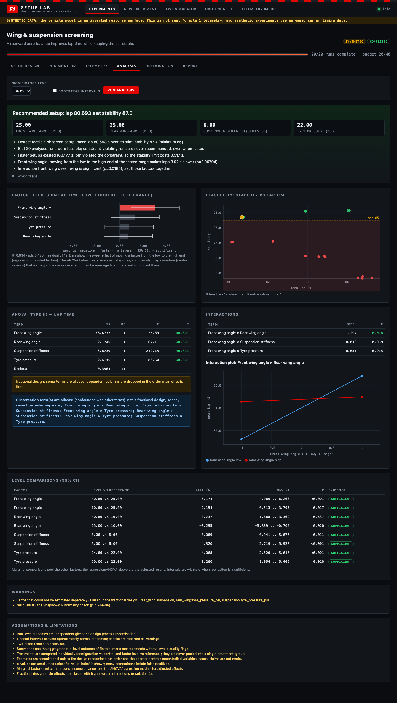

# F1 SETUP LAB

A browser-based **design-of-experiments workstation** for vehicle setup, built entirely on the **TRIALFORGE** SDK
(`trialforge-core`, in [`../skeleton`](../skeleton)). Define setup variables, a lap-time objective and a stability
constraint; generate a fractional-factorial screening design; run it; see which factors matter (ANOVA, interactions, confidence
intervals); let a Bayesian optimiser refine the setup; export a justified recommendation. No Python or command line is needed to *use* it.

The app works with **three data sources**, kept clearly labelled everywhere:

| Mode | Source | Label | What it is |
|---|---|---|---|
| **Synthetic** (default) | Built-in vehicle model | `SYNTHETIC` | An invented response surface. Not real F1 telemetry. |
| **Live simulator** | EA SPORTS F1 25 UDP telemetry | `SIM-RECORDED` | You drive stints in the game; the app records laps and verifies the game reported exactly the requested setup. |
| **Historical F1** | [OpenF1](https://openf1.org) (free, 2023+) or [FastF1](https://github.com/theOehrly/FastF1) (F1TV account, 2018+), both unofficial | `HISTORICAL F1 · OPENF1` / `HISTORICAL F1 · FASTF1` | Real Grand Prix sessions (timing, telemetry, position, weather) imported for analysis and benchmarking &mdash; never mixed into setup experiments. |



## Run it

Requires Python 3.11+. The simplest way is the start script at the repository root (`scripts/start-f1.sh`, see the root README): it
builds the SDK wheel if it is missing, creates `f1-setup-lab/.venv`, installs everything and starts the server. By hand:

```bash
cd f1-setup-lab
python -m venv .venv && . .venv/bin/activate
pip install ../skeleton/dist/trialforge_core-0.2.1-py3-none-any.whl   # build: python -m build --wheel ../skeleton/packages/trialforge-core
pip install -e ..                  # the root database package (trialforge-db)
pip install -e .
f1-setup-lab                       # or: python -m f1lab
```

Open <http://127.0.0.1:8001>. **All state lives in the repository's single root database** `data/trialforge.db` (set `TRIALFORGE_DB`
to use another file), shared with WATTWISE LAB but scoped per app: F1 SETUP LAB only sees its own experiments. Experiments, import jobs,
historical sessions (laps, telemetry, position, weather), raw UDP captures, stint evidence and decoded stint telemetry, probe reports and
mapping confirmations are tables in that file (`f1_*`). The only other directories are the download caches of the two historical providers, `data/fastf1-cache/` and `data/openf1-cache/`.
Restart the server and everything is still there (interrupted runs are recovered; interrupted imports are marked `INTERRUPTED` and can be
retried). Upgrading from a version with `data/f1lab.db`, Parquet sessions or evidence files: `python scripts/migrate_to_root_db.py` (root README). Interactive API docs: <http://127.0.0.1:8001/api/docs>.

## The workflow (all in the browser)

| # | Screen | What you do | Screenshot |
|---|---|---|---|
| 1 | **Dashboard** | See every experiment, progress, best feasible lap | [10](docs/screenshots/10-dashboard.png) |
| 1b | **New experiment: choose a data source** | Three cards. **Historical F1 data** (default, recommended): pick provider, season, Grand Prix, session and one, several or all drivers, choose which datasets to import, and the real session opens for analysis when the import finishes (no experiment is created). **Synthetic simulator** (`#/new/synthetic`) and **Live simulator** (`#/new/live`) are the setup-experiment modes | — |
| 2 | **New experiment (synthetic simulator)** | Pick factors and ranges (front wing, rear wing, suspension, tyre pressure), minimise lap time, minimum stability, design method, budget | [02](docs/screenshots/02-experiment-creator.png) |
| 3 | **Setup design** | Inspect the generated setups: 2<sup>4-1</sup> fractional factorial, resolution IV, `I=ABCD`, alias structure, randomised order | [03](docs/screenshots/03-setup-design.png) |
| 4 | **Run monitor** | Run on the simulator, watch results arrive; cancel, retry failed runs; infeasible setups flagged | [04](docs/screenshots/04-run-monitor.png) |
| 5 | **Telemetry** | Lap/sector charts per run; import a recorded CSV (s or ms) with unit conversion and outlier flagging; attach it to a queued run. Live experiments: **Stint telemetry** inspector (below) | [05](docs/screenshots/05-telemetry.png), [13](docs/screenshots/13-telemetry-import.png), [14](docs/screenshots/14-stint-inspector.png) |
| 6 | **Analysis** | Factor effects with 95% CI, Type II ANOVA, interactions, feasibility plot, written justification | [06](docs/screenshots/06-analysis.png) |
| 7 | **Optimisation** | Preview and run Bayesian-optimisation proposals; convergence chart | [07](docs/screenshots/07-optimisation-preview.png), [08](docs/screenshots/08-optimisation-result.png) |
| 8 | **Report** | Printable HTML report, JSON, CSV exports, reproducibility facts | [09](docs/screenshots/09-report.png) |
| 9 | **Live simulator** | Listen for EA SPORTS F1 25 UDP telemetry, watch live speed/throttle/brake/tyre charts, record verified stints | — |
| 10 | **Historical F1** | Browse seasons/events, import real sessions via OpenF1 or FastF1, analyse laps, telemetry, track map, weather and driver comparisons | — |

Demo datasets: `data/demo_telemetry.csv` (seconds) and `data/demo_telemetry_ms.csv` (milliseconds): 8 laps, one deliberately slow lap
that gets flagged. Both load from the Telemetry screen ("Load demo"). Failures are easy to demo: set *Demo fault rate* to 1 and *Retries* to 0
on the creator form (screenshot [12](docs/screenshots/12-failed-runs.png)); invalid input is explained inline ([11](docs/screenshots/11-validation-error.png)).

## How it uses the SDK (and what it does *not* contain)

The application contains **only** F1 knowledge: the vehicle model, the simulator adapter, telemetry CSV parsing, and the screens.
All experiment machinery comes from `trialforge`:

| App feature | TRIALFORGE API |
|---|---|
| Experiment definition, constraints | `ExperimentSpec`, `Factor`, `Objective`, `Constraint`, `MeasurementDefinition`, `ExecutionPolicy` |
| Fractional factorial / CCD / OFAT designs, alias structure | `ExperimentService.design` &rarr; `ExperimentDesigner` |
| Simulator | an app-owned adapter implementing the SDK protocol (`f1lab/adapters/sim_adapter.py`), registered in `AdapterRegistry` |
| Background execution, retries, cancel, restart recovery | `LocalBackgroundRunner`, `ExperimentService.execute / cancel / retry_run / recover` |
| Telemetry import, unit conversion, outlier flags | `MeasurementEngine`, `ExperimentService.ingest_measurements` |
| Effects, ANOVA, interactions, feasibility-aware best run | `ExperimentService.analyse` &rarr; `AnalysisEngine` |
| Optimisation (GP + Expected Improvement, constraint-aware) | `ExperimentService.optimise / add_runs` &rarr; `Optimizer` |
| Persistence, history, reports, CSV exports | `SQLiteExperimentRepository` (on the root database through the app-scoped subclass in `../db/scoped.py`), `ExperimentService.report`, `ReportEngine` |

Code map: `backend/f1lab/adapters` (vehicle model, simulator adapter, telemetry), `backend/f1lab/services` (`LabService`, narrative, HTML report),
`backend/f1lab/api` (FastAPI routes/schemas), `backend/f1lab/integrations/game_udp` (F1 25 / 2026-season UDP receiver, decoders, stint recorder),
`backend/f1lab/integrations/historical` (FastF1 client, importer, normalizer, database repository, durable import jobs, service),
`backend/f1lab/catalogs` (game setup catalog, manual mapping confirmations), `scripts/` (probe, verification, import and inspection tools), `frontend/` (no-build single-page app
with its own SVG charts). The app imports `trialforge` only through its public top-level API; a skeleton-level proof test enforces this.

## Live simulator mode (EA SPORTS F1 25)

Open **Live simulator** in the nav (or "New experiment &rarr; Live simulator"). In the game's telemetry settings enable UDP telemetry
(F1 25 or F1 25: 2026 Season Pack format), point it at the shown IP/port, then press **Start listening**. The **Live telemetry** charts
update from the decoded stream (speed, throttle/brake, steering, RPM, gear, clutch, DRS, rev lights, tyre temperatures/pressures,
track surface). For experiments, each generated setup is driven by you in the game garage; a stint is accepted only if the game
reported exactly the target setup for the whole stint, and the decoded telemetry is archived with the run as evidence.

**UDP setup (both formats).** In EA SPORTS F1 25, *Settings → Telemetry Settings*: UDP Telemetry **On**, UDP Broadcast Mode **Off**,
UDP IP Address = the computer running F1 SETUP LAB (`127.0.0.1` on the same machine), UDP Port = the port shown in the app (default `20777`),
UDP Send Rate 20–60 Hz, UDP Format **2025** (F1 25) or the **2026 Season Pack** format. The receiver decodes both (`packet_format` 2025 and
2026); any other format is counted as "wrong format" in the status panel, never guessed. Every accepted datagram is stored raw
(`f1_udp_packet`) so a session can be re-decoded; `python scripts/inspect_udp_recording.py` summarises a capture.

**Stint telemetry inspector.** *Experiment → Stint telemetry* opens the decoded samples archived with each submitted stint (accepted or
rejected): choose channels and a time window (or drag across a chart to zoom), hover for the exact measured sample, replay at 1x/4x/10x,
and compare two stints. Charts draw min/max-downsampled points when a window has more than 600 samples; the readout and the CSV/JSON
downloads always use every measured sample. Channels missing from a recording are listed and never drawn as zero. Two-stint comparisons
use distance **derived** by integrating measured speed, because the stored UDP samples have no lap-distance field.

**Verifying the four setup mappings (manual gate).** The catalog keeps `verified: False` for front wing, rear wing, on-throttle differential
and rear anti-roll bar, and no code path changes that by itself:

1. `python scripts/probe_setup.py --guided` asks you to move one control at a time to its lowest and highest position, stores the raw
   packets and a report: which decoded field changed, whether it matched the catalog's expected field, the values seen.
2. Compare those values with the numbers shown in the garage.
3. `python scripts/verify_setup_mapping.py confirm --factor front_wing --variant f1-25 --report <report_id> --by "your name"` (or `--reject`).
   `f1-25` and `f1-25-2026` are confirmed separately. `verify_setup_mapping.py status` and `GET /api/game/verification` show each factor's
   status and its source; experiments and reports stay flagged until every factor they use is confirmed.

## Historical F1 mode (FastF1)

Open **Historical F1**. Pick a season and Grand Prix, choose a session (FP1&ndash;FP3, Q, SQ, S, R), optionally select drivers, and import.
FastF1 downloads the session (coverage starts in 2018; data appears after a session finishes), the importer normalizes laps, car telemetry,
track position and weather into the root database (`f1_hist_*`, written in one transaction: a failed import leaves nothing behind), and the session screens provide lap/sector analysis, telemetry traces,
a track map with corner markers, weather/tyre-stint views and driver-vs-driver comparisons with an interpolated time delta.
Lap validity follows the timing feed: laps deleted by the stewards (`Deleted`) are marked invalid, while `IsAccurate` (timing alignment
quality) is stored separately and never treated as a deletion. The car `Brake` channel is published by FastF1 as a boolean
"brakes applied" flag, so it is stored as `brake_applied` (0/100), not as a brake-pressure percentage.

Imports run as durable jobs (`f1_import_job`): progress survives a restart; an identical request returns the existing job instead of
downloading again (`?force=true` re-downloads); failed or cancelled imports can be retried; every failure has a code (`NETWORK_TIMEOUT`,
`NETWORK_ERROR`, `EVENT_NOT_FOUND`, `SESSION_UNAVAILABLE`, `DRIVER_NOT_FOUND`, `NO_LAP_DATA`, `INVALID_REQUEST`, `INTERRUPTED`, `CANCELLED`).
Missing telemetry or position for a driver completes the import with a warning (`partial: true`). All imports share one FastF1 cache
(`data/fastf1-cache/`) and the job says whether data was downloaded or served from the cache. Command line:

```bash
python scripts/import_historical.py --year 2024 --event Monza --session Q --drivers VER LEC
python scripts/inspect_historical_session.py <session_id>
python scripts/smoke_fastf1_import.py --year 2024 --event Monza --session Q --drivers VER LEC   # exit 0 PASSED, 1 FAILED, 3 SKIPPED
```

A SKIPPED smoke test is never a pass.

**Credentials and subscription.** FastF1 3.9 requires authentication for the protected Formula 1 live-timing archive, and the account must
have an **active F1TV Access, Pro or Premium subscription**. A free Formula 1 account is not enough; see FastF1's
[F1TV account authentication](https://docs.fastf1.dev/api_reference/accounts_auth.html) documentation. FastF1 reads the login from
`F1_USERNAME` and `F1_PASSWORD` (password sign-in is the default; `FASTF1_AUTH_METHOD=password` selects it explicitly) and stores the
resulting token for reuse. Without valid subscription credentials, sessions load without lap timing and the import fails with `NO_LAP_DATA`.
This is what happened for 2024 Monza Q while building this version, with no credentials set. The error message says whether credentials were
missing or set but not accepted. If your account has no eligible subscription, retrying will not help: it is an access requirement, not a
code problem.

```bash
read -r -p "F1TV email: " F1_USERNAME; read -r -s -p "F1TV password: " F1_PASSWORD; printf '\n'
export F1_USERNAME F1_PASSWORD
```

Set them in your shell or service environment, never in code or shared files. The web app never prompts on the terminal, so an import cannot
hang waiting for input; `import_historical.py` run in a terminal may prompt.

**Attribution.** Historical data comes through [FastF1](https://github.com/theOehrly/FastF1), an unofficial community library reading
Formula 1's live-timing feed. It is not affiliated with or endorsed by Formula 1; the data belongs to its owners. Coverage and accuracy
vary by season and session.

**Simulator data vs real F1 data.** `SIM-RECORDED` values are what you drove in a video game: they show how a game setup changed your lap
times, not how a real car behaves. `HISTORICAL F1` values are real race-weekend timing and telemetry but contain no car setup, so they never
enter a setup experiment. `SYNTHETIC` values come from an invented model. The three never mix.

## Historical F1 mode: OpenF1 provider
[OpenF1](https://openf1.org) serves historical Formula 1 data **from the 2023 season onwards, free and without an account**. In **Historical F1**
the *Data source* selector defaults to OpenF1; FastF1 stays available (it is the API and CLI default, and the only source before 2023). From the
command line:
`python scripts/import_historical.py --provider openf1 --year 2025 --event "Abu Dhabi" --session R --drivers VER HAM`
(`--no-race-data` skips the race datasets, `--refresh-cache` downloads everything again). Inspect what was stored with
`python scripts/inspect_historical_session.py openf1-2025-abu-dhabi-grand-prix-r`.

| | OpenF1 | FastF1 |
|---|---|---|
| Seasons | 2023 onwards (what exists depends on what you import; nothing is bundled) | 2018 onwards |
| Account | none | F1TV Access/Pro/Premium |
| Session id | `openf1-<year>-<event>-<session>` | `fastf1-<year>-<event>-<session>` |
| Brake | on/off, stored as `brake_applied` (0/100) | on/off, stored as `brake_applied` |
| Not provided | steering, corner positions, steward lap deletions/validity | corner positions need circuit info |

### Starting from New experiment
**New experiment** opens on **Historical F1 data**, with OpenF1 preselected (free, no account). The same selector is used on the Historical F1 page.
Seasons run from the provider's first year to the current one (the newest season with no published Grand Prix steps back to the latest one that has
data). The Grand Prix, session and driver lists are loaded from OpenF1 or FastF1, never typed in: changing the season reloads the Grand Prix list,
changing the Grand Prix reloads its sessions, and changing the session reloads that session's driver roster (number, code, name, team). Drivers are
searchable and multi-selectable; the default is the whole field. A "car" is the driver's entry in that session (OpenF1 publishes no separate chassis).
Lap times are always imported; telemetry, track location, weather and each OpenF1 dataset (race results, running position, grid, tyres and pit stops,
overtakes and intervals, race control, team radio) can be switched off. When the import completes the session analysis opens.
Historical data cannot reveal setup parameters, so it never feeds the setup design or the optimiser.

### Which OpenF1 endpoints are used
All 18 documented endpoints are integrated except the per-lap mini-sector arrays (`segments_sector_*`) and the driver headshots/team colours.

| OpenF1 endpoint | Stored as | Shown in |
|---|---|---|
| `meetings`, `sessions`, `drivers` | event list, session list, driver list | import form, overview |
| `laps` | lap table incl. sector times and `i1_speed_kph`, `i2_speed_kph`, `st_speed_kph` | Lap analysis |
| `stints`, `pit` | compound, stint, tyre life; pit stops (manifest) | Lap analysis, Pit, flags & radio |
| `car_data` | per-driver telemetry (speed, throttle, brake on/off, gear, rpm, raw DRS code) | Telemetry, Compare |
| `location` | per-driver x/y/z track location | Track map |
| `weather` | air/track temperature, humidity, wind, pressure, `rainfall_flag` | Weather & tyres |
| `race_control` | flags, safety car, messages (manifest) | Pit, flags & radio |
| `position` | **running order** over time (`race_position` dataset) | Race & results |
| `session_result` | classification, DNF/DNS/DSQ, points, times | Race & results |
| `starting_grid` | grid (filed by OpenF1 under the *qualifying* session; the importer looks it up there) | Race & results |
| `intervals`, `overtakes` | gaps to leader and car ahead; overtake events (race and sprint only) | Race & results |
| `team_radio` | clip links (https only; the audio stays on Formula 1's server) | Pit, flags & radio |
| `drivers_championship`, `teams_championship` | standings (beta endpoints, race sessions only); available through the API and CLI only, with no screen or import option in the UI | none |

`location` (where the car is on the circuit) and `position` (P1, P2, ...) are different datasets and are never mixed: the UI says *track location*
for the first and *running order* for the second. Per-session datasets live in `f1_hist_dataset` (migration 7) and are served by
`GET /api/historical/sessions/{id}/datasets/{name}` (`race_position`, `session_result`, `starting_grid`, `intervals`, `overtakes`, `team_radio`,
`drivers_championship`, `teams_championship`, `pit_stops`, `race_control`; optional `driver` and `limit`).

### What the real API turned out to do (checked against api.openf1.org, November 2026)
* The starting grid is not under the race's session key. It is under the qualifying-type session (Qualifying for a race, Sprint Qualifying or the
  2023 "Sprint Shootout" for a sprint).
* Both championship endpoints returned no rows for every race and sprint tried (2023 to 2026). They are imported and reported as `empty` with a
  "beta endpoint" note, never filled in.
* A driver who retires has `position: null` with `dnf: true`; the UI shows the status, not a blank. Qualifying results carry one time per phase (Q1, Q2, Q3).
* The 2023 Bahrain Grand Prix has no `pit` rows although its stints show tyre changes. Pit stops are not reconstructed from stints.
* `stop_duration` is only published from the 2024 United States GP onwards. Lapped drivers have a text gap such as `+1 LAP`, not seconds.
* Team radio is a limited selection of clips and is thinner in 2026.

### Throttling, cache and refresh
* Requests are limited to 3 per second and 30 per minute, retried with back-off on HTTP 429 and 5xx (honouring `Retry-After`), and can be cancelled
  between requests. OpenF1 publishes no quota; the limits are deliberately conservative, so a full 20-driver race with car data and location
  (30-minute windows) takes several minutes the first time. Tick off *race data*, telemetry or location in the form to import less.
* Every non-empty answer is cached in `data/openf1-cache/` with the time it was fetched. Answers expire after **30 days** (`OPENF1_CACHE_TTL_DAYS`;
  `0` disables the cache). A session that finished within the last 48 hours may still be gaining data, so its cached answers are only trusted for
  an hour and the import warns you. Empty answers are never cached.
* **Refresh:** tick *download again, ignoring the OpenF1 cache* (API field `refresh_cache`, CLI `--refresh-cache`) to re-download one session.
  *Clear cache* in the form (or `DELETE /api/historical/openf1/cache`) removes every cached answer; stored sessions are kept. A normal
  re-import of a stored session reuses the cache and sends no request for data it already holds.
* **Provenance:** the session overview's *Import coverage* panel lists, per dataset, the status (`ok`, `empty`, `error`, `not applicable`), rows,
  downloads and cache hits, and the oldest answer's fetch time.

### Partial imports
Laps are required. Everything else is optional. `partial: true` means an endpoint failed or a driver is missing car or location data. An empty
beta endpoint, or one that does not apply to the session type (grid, gaps and overtakes for practice or qualifying), is reported but is not a failure.

### Estimated and missing values (also listed in each manifest)
* **Estimated here:** `distance_m` is speed integrated over time within each lap (OpenF1 has no distance channel) and lap numbers of samples come
  from OpenF1's lap start times, which OpenF1 calls approximate. `session_time_s` counts from the session start OpenF1 publishes. `tyre_life` is
  tyre age at stint start plus laps in the stint. `round` is the meeting's place in the season order.
* **Raw, not converted:** x/y/z are OpenF1 location values in its own units with an arbitrary origin (not verified as metres, although the stored
  columns keep the canonical names `x_m`, `y_m`, `z_m`). DRS is the raw state code: 0 and 1 off, 8 detected, 10, 12 and 14 on, 2, 3 and 9 undocumented.
  `rainfall` is an on/off flag (`rainfall_flag`), not millimetres.
* **Not provided:** steering, corner positions, brake pressure, and lap validity. The UI shows lap validity as "not provided", never as zero invalid laps.

### Tests
* `tests/test_openf1.py`: the client, importer, cache expiry/refresh and API against a fake server (`tests/openf1_fakes.py`).
* `tests/test_openf1_fixtures.py`: every endpoint's field names and the normalizers against **real downloaded responses** in
  `tests/fixtures/openf1/` (2023 race, 2024 qualifying, 2024 sprint, 2025 race, 2026 race; refresh them with `scripts/refresh_openf1_fixtures.py`).
* `tests/test_ui_openf1.py`: the browser flow through every OpenF1 tab.
* Opt-in real-network suite: `RUN_NETWORK_TESTS=1 pytest tests/test_openf1.py -k live` imports one driver from each of the five sessions above
  (it takes several minutes because of the throttle). The default test run never contacts OpenF1.

**Attribution.** Data from OpenF1, an unofficial open-source API, not affiliated with Formula 1. OpenF1 data is not EA SPORTS F1 game data and
never enters a setup experiment.

## Reading the results honestly

* The recommended setup is always the best **measured, feasible** run. Runs violating the stability constraint are never recommended, even if faster,
  and the report states what the constraint costs.
* Bar charts show the *linear* low-to-high effect; the ANOVA treats levels as categories and also detects curvature, so a factor can differ between the two.
* In a fractional design, two-factor interactions are aliased in pairs; the design screen and analysis say which.
* Optimisation results vary. With the bundled model, three reproducible demo experiments (ids `opt-loop-1..3`) improved the best feasible lap by
  0.38 s, 0.55 s and 0.00 s after 12 optimiser runs. The model-based loop does not guarantee improvement in a handful of runs.
* Simulated runs are reproducible: results are seeded from the experiment id, so set `experiment_id` in the API (or reuse an id) for identical data.

## Tests

```bash
pip install -e ".[test]"
python -m playwright install chromium     # only for the browser tests
python -m pytest                          # API/backend tests + real-browser end-to-end (skipped without Chromium)
```
Backend tests cover validation, constraint handling, failed runs and retries, cancellation, telemetry import, optimisation, reports, restart persistence,
the UDP receiver/decoders and stint recording, and the historical importer/normalizer/repository against a fake FastF1 session. The browser tests walk
the whole workflow with the mouse and regenerate `docs/screenshots/`.

## Limitations

Single-process server per app (the SDK's local background runner); one SQLite file shared by both apps (WAL mode); no user accounts; historical sessions are analysis-only and contain no car
setup configuration; FastF1 coverage/accuracy varies by season and the live mode depends on the game's UDP output being enabled; the synthetic
vehicle model is deliberately simple; statistical limits are those of the SDK (see `../skeleton/docs/limitations.md`).
